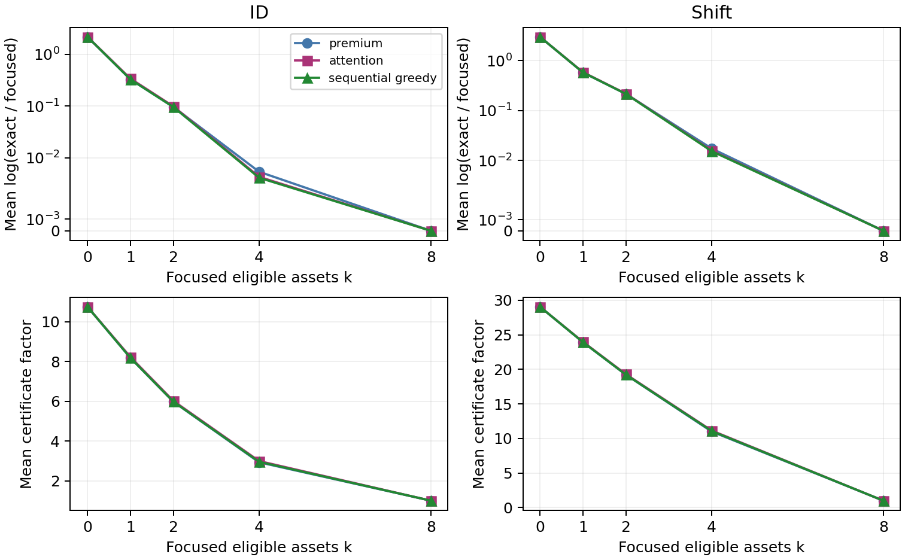

# Certified Focus Search for Relative-Regret Replacement from Censored Fleets

Certified Focus Search for Relative-Regret Replacement from Censored Fleets

Attention ablations, sharp omission bounds and a complete-family fallback

Nafis Wadud Ansari | Daffodil International University
ansari2305341800@diu.edu.bd

Working paper and research audit | 8 October 2026 | Historical novelty provisional

## Abstract

Right censoring creates shared uncertainty across replacement ages. We study focused adversarial search for the ratio of two cohort cost rates, while retaining every unresolved asset in the true ambiguity set. We derive an omitted-premium factor valid for any learned or deterministic focus, an asymptotically sharp family, and a premium-optimal focus and minimum certified budget characterization. Intersecting this bound with the previous complete-family FPTAS preserves exact feasible witnesses and its decision tolerance. A fixed attention experiment improves proposal quality over premium ranking and a capacity-matched pointwise MLP, but a sequential greedy challenger has lower mean gaps. Retrained pooling/context ablations and validation selection favor greedy; 600 fresh synthetic cohorts confirm its small proposal advantage over premium ranking. Attention is optional guidance, not the source of the guarantee. These are model-specific candidate mathematical results; established architectural novelty, engineering benefit and historical priority are not claimed.

## 1. Scope and contribution boundary

Record i has positive integer horizon H_i and observed-failure flag delta_i. Compatible latent lives obey L_i=H_i when observed, and L_i>=H_i+1 otherwise. Every age uses the same life vector. Preventive cost is one and failure premium q_i is a positive exact rational. The ambiguity set is Cartesian; no iid survival law is fitted.

```
R_d(L) = [n + sum_i q_i 1{L_i <= d}] / sum_i min(L_i,d)
G(a,b) = sup_compatible_L R_a(L)/R_b(L)
W(a) = max_b G(a,b); choose an age minimizing W(a).
```

The contribution proposed for review is the specialized focus certificate and its limits, not Transformers, minimax regret, scenario reduction or generic interval composition. The existing heterogeneous solver, continuous-clock results and earlier negative engineering outcomes are retained. This follow-up does not extend the certificate to sensor policies, intervention dynamics or future populations.


---

## 2. Exact subset reduction and focused search

Fix a<b. Let C_a,C_b be total costs when all censored assets survive both ages; let T_a,T_b be corresponding total uses, including every known failure. Thus C_a<=C_b. Eligible shared failures are E={i: delta_i=0, H_i<a}. A subset S of E fails at H_i+1; other censored assets survive b. Write Q(S)=sum_(i in S)q_i and s(S)=sum_(i in S)(H_i+1).

```
f(S) = (C_a+Q(S))*(T_b-b*|S|+s(S)) /
       ((C_b+Q(S))*(T_a-a*|S|+s(S)))
G(a,b) = max_(S subset E) f(S).
```

Reduction justification. A censored failure in (a,b] leaves the earlier rate unchanged while increasing later cost and decreasing later use, so survival is at least as adversarial. Within a shared-failure subset, costs are fixed and the exposure quotient is B/A with B>=A. Its derivative with respect to the sum of shared uses is (A-B)/A^2<=0; earliest compatible failures maximize it. Lifetimes beyond b are equivalent for this pair. These observations give the finite subset representation without a physical life cap.

For an arbitrary focus F subset E, enumerate only S subset F and define g_F=max f(S). All unfocused assets remain in the baseline costs and uses. Focus affects computation, not what is considered compatible. A maximizing subset gives a life vector attaining g_F exactly. Floating-point attention logits are used only to rank indices; certificate arithmetic uses exact fractions.

## Theorem A1. Selector-independent omitted-premium bound

```
Q_tail = sum_(i in E minus F) q_i
kappa_F = ((C_a+Q_tail)*C_b)/(C_a*(C_b+Q_tail))
g_F <= G(a,b) <= kappa_F*g_F.
```

Proof. Split a maximizing S into S_F=S intersect F and its tail. Add tail shared failures one at a time at times t<=a. Each replaces uses (a,b) with (t,t). Before addition B/A<=b/a because every asset has min(L,b)<=b*min(L,a)/a. For t<a, (b-t)/(a-t)>=b/a, so removing this pair cannot increase B/A. For t=a only B decreases. The cost quotient multiplier, with x=Q(S_F), y=Q(S minus F), is

```
K(x,y) = ((C_a+x+y)*(C_b+x))/((C_b+x+y)*(C_a+x))
       = 1 + y*(C_b-C_a)/((C_a+x)*(C_b+x+y)).
```

K increases in y and decreases in x. Hence f(S)<=K(0,Q_tail)f(S_F)<=kappa_F*g_F. Every focused subset is compatible, proving the lower bound and attaining witness. This proof holds even for an adversarial, untrained or shifted selector. It is deterministic containment, not a statistical confidence interval.


---

## 3. Sharpness, optimal focus and complete-family integration

## A2. A sharp uniform factor

Take two records: censored H=a-1 with premium 1, and known failure at b=a+1 with premium 3, a>=2. With empty focus, C_a=2,C_b=5,Q_tail=1 and kappa=5/4. Direct evaluation of the two subsets gives

```
g_F = 2*b/(5*a)
G/g_F = (5/4)*(1-1/(2*b)) -> 5/4.
```

The shared-failure subset is strictly optimal for every a>=2. A smaller factor based only on these same cost summaries fails along this family. This does not preclude horizon-dependent tighter bounds or establish selected-policy-bound sharpness.

## A3-A4. Premium-optimal focus and a minimum certified budget

At a fixed cardinality k, choosing the k largest eligible premiums minimizes Q_tail and therefore kappa. No attention rule can uniformly improve this factor at that k under A1. A smaller factor alone need not give a smaller absolute upper bound kappa*g_F. For 0<epsilon<=1, every focus qualifies if C_b<=(1+epsilon)C_a; otherwise the factor requirement is exactly

```
kappa_F <= 1+epsilon  iff
Q_tail <= epsilon*C_a*C_b / (C_b-(1+epsilon)*C_a).
```

The shortest descending-premium prefix meeting that tail threshold has minimum cardinality among focuses certified by A1. This is an algebraic corollary, not a new polynomial solver: enumerating k focused assets requires 2^k subsets. If C_a=C_b, even empty focus is exact, so this pair does not require attention.

## Retaining the strongest existing certificate

The final implementation uses validation-selected greedy proposals by default, also checks premium focus, and intersects their intervals with the existing FPTAS interval. An optional learned selector replaces the greedy proposal. Let l be the maximum lower endpoint and u the minimum upper endpoint; retain the compatible witness attaining l. Since each interval contains G, l<=G<=u. The FPTAS fallback ensures u<=(1+epsilon)l.

```
L_a=max_b l(a,b); U_a=max_b u(a,b)
a_hat in argmin_a U_a
W(a_hat) <= U(a_hat) <= U(a_star)
         <= (1+epsilon)*L(a_star) <= (1+epsilon)*W(a_star).
```

Later-versus-earlier pairs retain the exact premium-prefix solver. If U(a_hat)<=min_(a!=a_hat)L_a, selection is an exact minimizer; a strict inequality certifies uniqueness. The composition logic is standard. Running the full fallback adds work, so this wrapper is not claimed to accelerate the pipeline.


---

## 4. Fixed attention experiment and statistical limits

The first plan was hashed before outcomes. Training uses 1,600 synthetic cohorts, validation 200, and held-out ID/shift tests 300 each. Every pair has eight censored eligible assets and two known failures between a and b. ID uses ages 16-48 and broadly varying premiums; shift uses ages 40-80, larger age gaps, horizon-correlated unknown premiums and larger known premiums. Gold subset membership is solved from public inputs, never hidden future lifetimes. Seeds and all records are saved.

Attention has one width-32 two-head Transformer block, no positional embedding and 8,993 parameters. The pointwise MLP has 9,065 parameters and the same 12 public features. Three model seeds use Adam .002, batches 64 and 25 epochs; validation BCE chooses a checkpoint. Exact focused search uses k=4 (16 subsets); full eight-asset search is the evaluation oracle (256 subsets).

Primary outcome is log(G_exact/g_F), lower better. Original results average three seed metrics within each cohort. Four planned attention-minus-baseline mean contrasts use two-sided Monte Carlo sign flips, 9,999 draws, Holm adjustment and 2,000 cohort-bootstrap draws. Independent units are 300 cohorts per split, not 900 seed results.

| Original protocol | ID mean gap | Shift mean gap | ID kappa | Shift kappa |
| --- | --- | --- | --- | --- |
| attention | 0.004706 | 0.015685 | 2.995 | 11.152 |
| mlp | 0.005143 | 0.019922 | 2.982 | 11.456 |
| premium | 0.005342 | 0.017257 | 2.930 | 11.005 |
| singleton | 0.005342 | 0.017087 | 2.930 | 11.005 |
| premium_per_use | 0.011474 | 0.040864 | 3.275 | 12.508 |
| horizon | 0.299339 | 0.632216 | 7.004 | 23.439 |
| random | 0.361611 | 0.294190 | 7.301 | 18.638 |

| Contrast | Mean difference | Nominal 95% bootstrap CI | Holm p |
| --- | --- | --- | --- |
| id vs premium | -0.0006359 | [-0.0010095, -0.0003025] | 0.0004 |
| id vs mlp | -0.0004366 | [-0.0008433, -0.0000868] | 0.0195 |
| shift vs premium | -0.0015726 | [-0.0021796, -0.0010115] | 0.0004 |
| shift vs mlp | -0.0042375 | [-0.0055537, -0.0030553] | 0.0004 |

All four mean contrasts reject under the test assumptions, but effect size and novelty differ. ID attention versus premium has 26 wins, 267 ties, 7 losses. Greedy, added after this plan, has means .004608 ID and .015272 shift, below attention in both. The primary table is preserved rather than retrospectively replacing its controls.

Sign flips require exchangeability/symmetry under the null. Bootstrap intervals condition on fitted models and are neither simultaneous nor training-uncertainty intervals. These tests measure a synthetic adversarial proposal, not realized maintenance improvement or historical originality.


---

## 5. Retrained ablations and fresh confirmation

After the first outcomes, a separately hashed follow-up plan fixed two retrained ablations: pooled set context (9,053 parameters), and attention with six broadcast pair-context features zeroed (8,993 parameters). Token horizon/age normalization and eligibility still encode the pair; the latter is not removal of all conditioning. Both use the same three seeds and schedule. The follow-up deployment protocol averages checkpoint logits before top-k, unlike averaging the original seed metrics.

| Selector | Original ID | Original shift | Fresh ID | Fresh shift |
| --- | --- | --- | --- | --- |
| attention | 0.004688 | 0.015679 | 0.005417 | 0.019199 |
| no_broadcast_attention | 0.004707 | 0.015751 | 0.005445 | 0.019646 |
| pooled | 0.004867 | 0.019959 | 0.005644 | 0.024262 |
| mlp | 0.005171 | 0.019843 | 0.005772 | 0.023705 |
| sequential_greedy | 0.004608 | 0.015272 | 0.005355 | 0.018576 |
| premium | 0.005342 | 0.017257 | 0.006056 | 0.019801 |
| singleton | 0.005342 | 0.017087 | 0.006056 | 0.019437 |
| premium_per_use | 0.011474 | 0.040864 | 0.013037 | 0.045399 |
| horizon | 0.299339 | 0.632216 | 0.312798 | 0.590975 |
| random | 0.361611 | 0.294190 | 0.362063 | 0.280915 |

On 200 validation cohorts, greedy minimizes mean gap (.003026), followed by attention (.003065), no-broadcast attention (.003156), pooled (.003219) and MLP (.003269). The choice was saved before generating 300 fresh ID and 300 fresh shift cohorts with new seeds. All candidate results remain visible; the selected method is not changed after confirmation.

| Selected greedy vs premium | Mean difference | Nominal 95% CI | Holm p |
| --- | --- | --- | --- |
| id | -0.0007011 | [-0.0011083, -0.0003789] | 0.0004 |
| shift | -0.0012248 | [-0.0017036, -0.0007953] | 0.0004 |

Fresh wins/ties/losses are 29/271/0 ID and 42/258/0 shift. Greedy-versus-itself gives structural ties and p=1 in the fixed four-test family; this is not independent superiority evidence. Fresh confirmation supports a small proposal benefit against premium for the chosen rule, not a new greedy algorithm. Broadcast context has only a small descriptive effect here. Attention helps compared with the pointwise ablation, but has not established necessity or superiority over greedy.

Original-set ablations are exploratory because earlier outcomes motivated them. Fresh cohorts supply a cleaner validation-selected confirmation for the stated synthetic laws, not for prospective equipment failure or a new physical domain.


---

## 6. Budget, certificate-removal and precision ablations



Figure 1. Original held-out cohorts; follow-up ensemble protocol. The upper panels use a symmetric-log axis with a linear region near zero. Focus grows along a fixed model ranking; greedy recomputes each marginal. Full focus is exact for every rule. Kappa is a deterministic worst-case factor, not a confidence interval.

| At k=4 | Final subsets | Proposal subsets | ID optimum coverage | Shift coverage |
| --- | --- | --- | --- | --- |
| Premium | 16 | 0 | 72.67% | 31.00% |
| Attention ensemble | 16 | neural inference | 75.33% | 37.00% |
| Sequential greedy | 16 | 172 | 76.33% | 38.33% |

At k=1,2 attention has higher mean gaps than premium on both distributions; its ranking was trained on optimum membership, not all budget objectives. At k=4 proposal gaps are small but certificate factors remain around 3 ID and 11 shift. Premium sorting minimizes kappa at fixed k by A3. At k=8 all gaps are zero, kappa=1, and the final search enumerates 256 subsets; greedy additionally performs 1,004 proposal subset evaluations. Counts exclude neural inference, sorting and the full fallback, so they are not runtime measurements.

## Removing the omission certificate fails mathematically

```
H=(1,3), delta=(0,1), q=(100,1), a=2, b=3, F=empty
g_F=1, but compatible L=(2,3) gives G=255/206 > 1.
kappa_F=153/103 retains the omitted uncertainty.
```

Treating unfocused assets as known survivors and declaring g_F exact is false. Conversely, no known failures between the pair gives C_a=C_b and empty focus exact: attention is unnecessary. The fallback intersection retains its previous tolerance for any focus. Functional complete-family checks do not demonstrate cost or time improvements.


---

## 7. Failure synthesis and assumptions that remain

| Earlier direction | Evidence and failure | Retained component |
| --- | --- | --- |
| CAT / transfer | CAT-c improves failure-containing cells over 1-SE on 0/6 engine datasets; battery LOBO failures 25.2-34.15%. | Explicit information/feasibility contract; no transferred safety theorem. |
| RAMPE | All 6,080 episodes equal fallback 1-SE; gates abstain everywhere. Verdict D. | Declared fallback; reject renamed reliability scores and unsupported RL. |
| Observability / generic LP | All 29,184 cap evaluations reproduced; no novel optimizer; grouped sensitivity 0/21 Holm rejections. | Public/sealed separation, matched information; no fabricated sensor-prefix replay. |
| Shared-clock / linear solver | Exact structure and witnesses; mixed performance, 13 favorable and 15 unfavorable corrected synthetic comparisons. | Same-world quotient and exact computational reductions. |
| Heterogeneous fleet | 304 constructed-cost replays: 5 wins, 291 ties, 8 losses; mean regret change +.004718477. | Complete-family FPTAS and actual-loss-stage certificate. |
| Attention / follow-up | Small gains over MLP/premium; greedy wins validation and has lower average gaps. Focus factors remain loose. | Optional proposal plus independently valid omission certificate. |

Detailed source paths, all retained negative findings and limits are in FAILURES_AND_LIMITATIONS.md. These are different experiments and metrics; they are not pooled into a single success score. The 1966 Fox access issue is closed by the supplied full-text audit; older reports retain their original chronology.

The final method assumes exact observed horizons/flags, fixed integer ages, positive rational premiums, common preventive cost and independent compatible completions. It does not model joint physical constraints, downtime, imperfect repair, adaptive sensors, intervention effects or limited maintenance resources. The trained cohort has eight eligible assets; large-fleet and variable-size generalization is untested. Cost scenarios are constructed, not measured consequences.

Running all proposed intervals plus the full fallback preserves precision and can tighten endpoints, but adds overhead. No end-to-end speedup, prospective cost benefit, population risk control, causal effect or accepted-paper status has been established. The finite-cohort guarantee concerns W, which can prefer a policy with worse mean realized cost. Statistical significance and exactness cannot establish historical originality.


---

## 8. Literature boundary, reproducibility and review claim

Transformers [1], pooled set learning [2], set attention [3] and attention-based combinatorial proposals [4] are established. Censored RUL Transformers [5] prevent a broad first-attention-maintenance claim. NeurPRISE [6] is especially close: it uses Transformer interactions for robust scenario selection, and its greedy PRISE comparator motivates our stronger challenger. Robust scenario reduction already has multiplicative guarantees [7,8]. Those general ideas are attributed, not claimed as new.

The precise candidate is the omitted-premium formula for this shared rate quotient, its sharpness family and minimum certified focus budget. The inspected primary statements do not show that formula, but the audit cannot exclude equivalent reformulations or earlier derivations. A specialized corollary may be insufficiently substantial for a stand-alone method paper. Verdict B: potentially novel but insufficiently established. No positive historical-priority verdict or 9/10 originality rating is supported.

The release includes two hashed plans, all 3,000 generated cohorts, twelve checkpoints/training histories, primary and follow-up outputs, exact math checks, unit tests, two verification scripts and a review archive. There are 1,600 training, 200 validation and 1,200 held-out synthetic cohorts. The 1,025 earlier protected files remain unchanged. Exact witness/interval checks cover the saved results; independent full-clock unit checks cover small cases. No real sealed lifetimes enter learned features or training labels.

For reproduction use the saved environment snapshot and README commands. Scores and certification are exact rational calculations; ranking uses floating point. Attention logits are not failure probabilities or causal explanations. No public preprint, DOI, external review or priority date has been generated for this project. The prepared claim needs independent specialist comparison and a measured engineering demonstration before an established original-method claim.

## Primary references

[1] Vaswani et al. (2017). Attention Is All You Need. arXiv:1706.03762.

[2] Zaheer et al. (2017). Deep Sets. NeurIPS 30.

[3] Lee et al. (2019). Set Transformer: A Framework for Attention-based Permutation-Invariant Neural Networks. PMLR 97, 3744-3753.

[4] Kool, van Hoof and Welling (2019). Attention, Learn to Solve Routing Problems! ICLR. arXiv:1803.08475.

[5] Noot, Martin and Birmele (2025). LSTM and Transformers based methods for Remaining Useful Life Prediction considering Censored Data. IJPHM 16(2). DOI:10.36001/IJPHM.2025.v16i2.4260.

[6] Lin, Zhou, Bi, Wu, Song, Cao and Zhang (2026). Learning Scenario Reduction for Two-Stage Robust Optimization with Discrete Uncertainty. arXiv:2605.14494v1.

[7] Goerigk and Khosravi (2023). Optimal scenario reduction for one- and two-stage robust optimization with discrete uncertainty in the objective. EJOR 310(2), 529-551. Author preprint arXiv:2209.00499.

[8] Aigner, Denzler, Liers, Pokutta and Sharma (2025/2026). Scenario Reduction for Distributionally Robust Optimization. arXiv:2503.11484v3.

Primary links, inspection depth and historical-equivalence gaps are in LITERATURE.md. Earlier exact/FPTAS results are project predecessors documented in the protected stage manuscripts, not independently published prior art.
