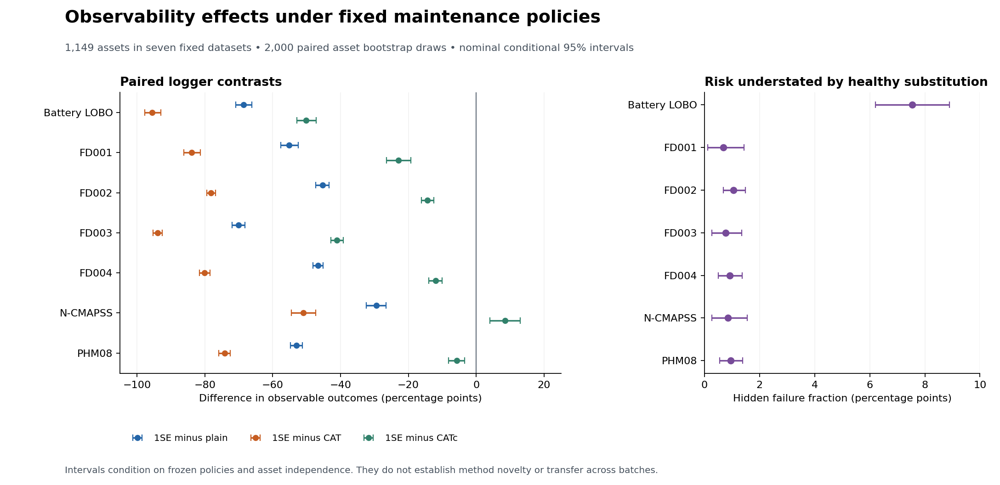

# Statistical validation and methodological novelty verdict

**NO: the project currently does not have an established novel method.** The new statistical analysis supports substantial conditional observability effects. The method audit independently reproduces all implemented intervals and certificates using established worst-case missing-outcome optimization. A useful benchmark candidate remains; that is a different claim from methodological novelty.

Date: 8 October 2026. Sources and earlier verdicts are frozen. New work is confined to `method_validation/` and `out/method_validation/`. This report supplements the completed CAT, RAMPE and observability investigations.

## What was tested

The primary analysis includes 1,149 unique assets: six engine datasets and the 123 Battery LOBO cells. Battery CV reuses those cells and is reported separately as sensitivity, never added to the primary asset count. Each asset retains every original cost/lead setting and logger-target combination when resampled. The fixed evaluation grid has 6,336 off-diagonal task cells in the primary regimes; those cells are not independent replicates. All eight regimes, including Battery CV, are retained in the mechanism audit.

For each asset, compute its observable-outcome fraction under each logger, averaging over all fixed settings and the other three target policies. Compare 1SE with plain, CAT and CATc. These compare **information available under fixed loggers**, not maintenance cost superiority or deployment safety. The target repertoire differs by logger only through exclusion of its always-observed self-pair; including self-pairs would simply multiply each difference by 3/4.

Two-sided exact sign tests use one paired contrast per asset and discard ties. The null is independent, balanced positive/negative signs conditional on nonzero differences and the frozen split/policy setting. It is not a zero-mean hypothesis. Holm correction covers the 21 primary tests together. Battery CV has its own three-test sensitivity family. Nominal mean-effect intervals use 2,000 complete-asset bootstrap draws, seed 20261008, resampled separately within each original outer split. These intervals are not adjusted for simultaneous coverage.

This plan was written before the new run but after the earlier findings were seen: it is post hoc, not preregistered. The initial plan and its original hash are retained. Interpretation amendments and the later exploratory outer-group sensitivity are documented transparently.

## Paired statistical results

All 21 primary asset-level contrasts have Holm-adjusted p<.05; the largest adjusted p is 0.01969. Twenty contrasts favor lower visibility under 1SE. The exception is N-CMAPSS versusCATc, where 1SE yields8.56 percentage points **more** visibility; adjusted p=.01969. Against plain andCAT,1SE has lower visibility in all seven fixed datasets.

The following prespecified contrast illustrates the effect size. Negative values mean less observable information under 1SE logging. Units are percentage points; intervals are nominal conditional95% bootstrap intervals.

| Dataset | Assets | 1SE minus CAT | Interval | Holm-adjusted sign-test p |
|---|---:|---:|---:|---:|
| Battery | 123 | -95.48 | [-97.68, -92.92] | 2.82e-36 |
| FD001 | 100 | -83.88 | [-86.15, -81.31] | 1.89e-29 |
| FD002 | 260 | -78.15 | [-79.37, -76.83] | 2.27e-77 |
| FD003 | 100 | -93.90 | [-95.23, -92.54] | 1.89e-29 |
| FD004 | 249 | -80.03 | [-81.53, -78.49] | 4.42e-74 |
| NCMAPSS6 | 99 | -50.95 | [-54.48, -47.35] | 1.15e-23 |
| PHM08 | 218 | -74.20 | [-75.96, -72.52] | 8.07e-65 |

All 24 primary/sensitivity tests, sign counts, ties, raw p-values and corrected p-values are available in `paired_sign_tests.csv`. The three Battery CV contrasts also pass their separate correction, but they are not independent confirmation from a new set of cells.

For a fixed-domain composite, give each of the seven primary datasets equal weight and each fixed task within a dataset equal weight. This differs deliberately from the older report's7296-task pooled weighting, which included both battery regimes. The conditional bootstrap estimates are:

| Estimand | Estimate | Nominal conditional95% interval |
|---|---:|---:|
| Observable outcomes | 54.38% | [54.17%, 54.59%] |
| Failure fraction hidden by healthy substitution | 1.83% | [1.55%, 2.10%] |

Healthy substitution underestimates the recorded finite-cohort failure fraction by 1.83 percentage points on average across these fixed datasets. This is not a future-population safety guarantee. Hidden failure fractions are nonnegative by construction; no artificial p-value is reported for that algebraic fact.

## Dependence and threshold diagnostics

The primary p-values assume independent asset signs conditional on frozen fitted policies. Shared fitted models, overlapping training folds, cell batch effects and related NASA datasets restrict what can be inferred. Models were not refitted; these calculations do not capture training or selection uncertainty, causal interventions, or sampling new domains.

The exploratory sensitivity collapses each contrast to one held-out split/batch mean. With only three Battery LOBO batches and five folds per engine dataset, **zero of 21 comparisons pass Holm correction**. Even unanimously directed means give two-sided sign p=.25 with three groups orp=.0625 with five. This is a low-power sensitivity result, not proof that the asset effect vanishes. It shows why the asset-level significance cannot be advertised as established generalization across batches or independent retrainings. These group-level tests also require independent balanced group signs; they do not remove shared-training dependence.

Certification and false-declaration proportions are threshold statistics. For several of them, the first ordinary percentile bootstrap range excluded the observed estimate. For example, the fixed-domain certified-gain estimate is15.83%, but its central resampling range is11.58–14.77%. The missed-share point estimate is68.02%, versus a70.11–76.59% resampling range. These diagnose boundary/tie behavior and bootstrap bias. They are labeled **resampling sensitivity ranges**, not reliable95% confidence intervals, and are not used to claim significance. Their full summaries include bootstrap means and point-outside-range flags. Initial files with the premature interval labels are retained only in `diagnostics_initial/` for audit history.

The primary inferential evidence therefore comes from the prespecified asset sign tests and linear mean-effect intervals. There is no significance test treating7296 task rows or 486400 budget rows as independent data, and no claim of independently replicated population validity.

## Independent mechanism reconstruction

LetC0,T0,F0 be sums of observed target costs, use and failures; letm be the number of unresolved outcomes andn the cohort size. Ifz unresolved outcomes fail and their total use isU, the admissible rate is

`(C0 + m + (rho - 1)*z) / (T0 + U)`,

with`0 <= z <= m` and`sum(H_unknown) < U <= m*cap`. The numerator increases withz and the ratio decreases withU. Standard rectangular worst-case optimization therefore gives the same lower/upper endpoints as the current evaluator. Failure risk is simply`(F0+z)/n`. The continuous upper endpoint is a supremum; using the closure does not imply the strict duration boundary is attained.

The independent baseline uses the established [Charnes–Cooper transformation](https://iiif.library.cmu.edu/file/Cooper_box00010_fld00009_bdl0001_doc0001/Cooper_box00010_fld00009_bdl0001_doc0001.pdf): set`s=1/(T0+U)`, normalize`T0*s + U*s = 1`, and solve the resulting linear objectives and inequalities. It does not import the evaluator's bound function, and its arguments contain only publicly observed aggregates and declared support constraints. Missing costs and durations are optimized, not obtained from sealed labels.

- Every one of 29,184 earlier cap evaluations was checked.
- 15,168 evaluations with missing outcomes each required two actual LP solves; complete-observation cases collapse analytically.
- Maximum endpoint absolute difference: 2.22e-16.
- Economic and risk certification mismatches:0.
- The generic baseline has exactly the same coverage, conservatism and decisions.

No superiority p-value is appropriate: the proposed and generic procedures are mathematically equivalent here. Zero false certification is explained by valid worst-case containment under the coarsened support assumptions. It is not statistical evidence for a new algorithm.

Being expressible as an LP would not by itself refute the novelty of a new formulation. In this implementation, however, there is no new structural constraint, estimator, optimizer or guarantee beyond monotone extrema over independent bounded missing outcomes. The paired dataset interface is what differs.

## Literature and the strict novelty gate

The new [primary-source audit](LITERATURE.md) covers generic missing-data partial identification, linear-fractional optimization, modern no-overlap policy evaluation and censored maintenance cost bounds. [Khan et al., ICML2024](https://proceedings.mlr.press/v235/khan24b.html) already develop no-overlap partial-identification policy evaluation under smoothness. [Coolen-Schrijner et al.](https://maths.dur.ac.uk/stats/people/ps/opport3.pdf) already derive maintenance cost bounds using censored nonparametric survival information. Our finite-cohort assumptions differ, but those differences do not establish a new general mechanism. The generic baseline tested here is not an empirical replication of either paper's additional assumptions.

| Required gate | Finding |
|---|---|
| Meaningfully different scientific problem | A project-specific paired information-loss question is useful; a distinct general methodological problem is unestablished. |
| Different mathematical formulation | Fails: elementary bounded missing-outcome extrema and a renewal cost/use ratio. |
| Different decision mechanism | Fails: ordinary worst-case upper-bound certification. |
| Existing methods cannot trivially reproduce it | Fails: independent generic LP reproduces every endpoint and certificate. |
| Difference matters scientifically | Observability effects matter empirically; no incremental method effect exists against the equivalent comparator. |
| Literature does not establish the same mechanism | Fails for the broad mechanism; exact benchmark priority remains unaudited comprehensively and externally unconfirmed. |

**Method verdict: reject the novel-method claim.** CAT/CATc remain established constructions; the frozen RAMPE verdict remainsD; the observability resource remains a possibleB benchmark/empirical contribution. These negative method verdicts are unchanged by smaller empirical p-values. There is no demonstrated new-method advantage over the generic bound baseline, so a claim of a statistically superior novel method is unsupported.

## What must change for a future method claim

A new name, an ensemble, an information bonus, or tighter box bounds will not suffice. At minimum, introduce a defensible problem/constraint/decision mechanism that changes the feasible inference or control problem and cannot be reproduced by the present generic baseline under the same assumptions. One research target is jointly choosing preventive replacement and feasible future data collection when the action changes which policy outcomes become observable, accounting for shared trajectories and maintenance costs. That is a **research hypothesis**, not an established novel direction: Bayesian censored learning, active sensing, POMDPs and safe exploration are already close prior art.

Before claiming a method, it would need a precise mechanism delta against those methods, a valid theorem under explicit assumptions, raw-prefix or physically justified intervention data, independent retrainings/batches, and comparative tests against the closest equivalent-assumption baselines. The current public/sealed replay cannot supply counterfactual lifetimes of equipment removed in real deployment. None of these missing items is represented here as a completed experiment.

## Delivered evidence and preservation

Reproduction commands from the repository root are in `README.md`. New outputs contain raw asset contrasts, corrected tests, all 2000 bootstrap draws per regime, threshold diagnostics, outer-group sensitivity, every generic-LP endpoint, figure, verification and hash manifest. Eight new unit tests independently check exhaustive small completions, all-observed/all-unknown cases, scale/cap sensitivity, Holm correction and diagnostic summaries. All 776 previously protected files remain byte-identical. Old reports and verdicts are preserved.

**Exact supported contribution statement:** a paired, coarsened outcome-summary replay resource and a conditional empirical demonstration that the logging policy strongly affects which competing-policy outcomes can be evaluated. Scientific priority for that resource is not established; a novel method is not established.
