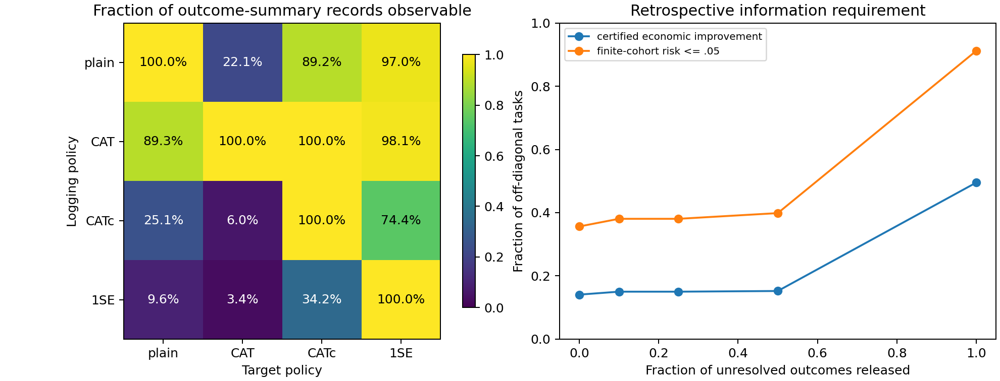

# A new research pivot: maintenance observability

## Status and exact proposed contribution

**Candidate contribution: a paired maintenance-policy observability benchmark and an empirical characterization of which full-lifetime policy comparisons remain supportable from intervention-censored outcome summaries.**

This is a concrete new artifact in this project. It is a **potentially novel benchmark/empirical contribution**, not an established novel learning algorithm. Classification: **B — POTENTIALLY NOVEL BUT INSUFFICIENTLY ESTABLISHED**. The artifact and finite-cohort calculations are verified; first-in-literature priority, physically valid intervention feedback and publication-level generalization remain unestablished. The prior RAMPE verdict remains D; its outputs were not edited or relabelled.

The conceptual pivot is from “choose the most reliable policy” to “determine whether the data permit a policy comparison at all”. Changing ensemble weights cannot recover observations that replacement has prevented. Existing research already establishes censoring, Bayesian maintenance learning, partial identification and partially observable control. The contribution candidate is the exact paired resource and empirical question, with transparent information contracts, not those broad ideas.

## What was added

The resource pairs four frozen policies as both logger and target across six engine datasets and Battery CV/LOBO, all original leads and cost settings. There are **9728 policy-pair tasks**, **325632 unit-pair records** in each of the public and sealed files, **29184 cap-sensitivity evaluations**, and **486400 information-budget evaluations**. These are repeated evaluation tasks over 1026 engines and 123 battery cells (battery protocols reuse cells), not that many independent physical assets.

`public_outcomes.csv.gz` exposes logger endpoints, observable logger outcomes and only target outcomes measurable within the outcome-summary observation contract. All unresolved target cost/use/failure entries are NaN. `sealed_truth.csv.gz` preserves evaluator answers separately; it is locally accessible for reproducibility and therefore is not a secure hidden leaderboard. The core evaluator accepts no truth file and rejects nonmissing unresolved outcome fields. A mutation test changes sealed unobserved outcomes without changing the public view or evaluator output.

The mask represents original-policy completion before logger removal, or a complete run-to-failure logger record. It is generated by a retrospective outcome replay. It does **not** pretend to be validated sensor-prefix execution: pending alarms and their known future deadlines could reveal additional information. Raw post-removal trajectories are not used by the public evaluator. This coarsening makes the contract conservative but materially narrower than a deployment-ready benchmark.

## Main empirical result

To avoid trivial self-policy pairs, headline counts use only the **7296 off-diagonal tasks** and cap5000. The mean observable fraction across tasks is **54.03%**. The full-lifetime evaluator finds **3614** target-versus-logger economic improvements; **1028** can be certified from the censored outcome summaries. **2586** actual improvements remain uncertified. This is a measurement/identification gap, not proof that those policies fail economically.

Deleting unresolved units gives **394** false economic-improvement declarations and **97** false finite-cohort risk≤.05 declarations. Treating unresolved units as healthy gives **87** false improvement and **418** false risk declarations. The interval evaluator gives **0** false improvement and **0** false risk declarations within the tested cohort/model. That zero is an algebraic containment consequence plus a data check, not evidence of future deployment safety.

All eight regimes, including negative results:

| dataset | analysis | observed_fraction | true_improvement | certified_improvement | ambiguous_improvement | complete_case_false_improvement | healthy_false_improvement | complete_case_false_safe | healthy_false_safe | hidden_rate_width |
| --- | --- | --- | --- | --- | --- | --- | --- | --- | --- | --- |
| Battery | cv123 | 0.52327 | 0.49583 | 0.070833 | 0.57292 | 0.030208 | 0.0041667 | 0 | 0.025 | 0.014216 |
| Battery | lobo | 0.55891 | 0.49306 | 0.27083 | 0.57465 | 0.0017361 | 0.083333 | 0.041667 | 0.19444 | 0.015322 |
| FD001 | engine | 0.53625 | 0.5 | 0.0875 | 0.69271 | 0.052083 | 0 | 0 | 0.0125 | 0.052481 |
| FD002 | engine | 0.54387 | 0.49167 | 0.17292 | 0.72813 | 0.073958 | 0.010417 | 0.021875 | 0.1 | 0.051396 |
| FD003 | engine | 0.53276 | 0.49583 | 0.10833 | 0.625 | 0.055208 | 0 | 0.0041667 | 0.0375 | 0.043811 |
| FD004 | engine | 0.52882 | 0.5 | 0.20521 | 0.74167 | 0.06875 | 0.0083333 | 0.0041667 | 0.070833 | 0.045259 |
| NCMAPSS6 | engine | 0.56614 | 0.48542 | 0.10521 | 0.73021 | 0.05 | 0.009375 | 0.029167 | 0.035417 | 0.18828 |
| PHM08 | engine | 0.54007 | 0.5 | 0.15833 | 0.75 | 0.079167 | 0.0083333 | 0.016667 | 0.0375 | 0.05054 |

Logger-target summaries:

| logger | target | observed_fraction | true_improvement | certified_improvement | complete_case_false_safe | healthy_false_safe |
| --- | --- | --- | --- | --- | --- | --- |
| 1SE | CAT | 0.033683 | 0.4227 | 0 | 0.039474 | 0.19737 |
| 1SE | CATc | 0.34186 | 0.54441 | 0 | 0 | 0.039474 |
| 1SE | plain | 0.095835 | 0.73191 | 0 | 0 | 0.0625 |
| CAT | 1SE | 0.98097 | 0.5773 | 0.52303 | 0.019737 | 0.019737 |
| CAT | CATc | 1 | 0.53289 | 0.53289 | 0 | 0 |
| CAT | plain | 0.89263 | 0.53454 | 0.26974 | 0.0065789 | 0.0098684 |
| CATc | 1SE | 0.74424 | 0.45559 | 0.10197 | 0.019737 | 0.019737 |
| CATc | CAT | 0.060126 | 0.45066 | 0 | 0.0082237 | 0.15789 |
| CATc | plain | 0.2512 | 0.76809 | 0.0032895 | 0.0065789 | 0.029605 |
| plain | 1SE | 0.97007 | 0.25493 | 0.16776 | 0.013158 | 0.013158 |
| plain | CAT | 0.22102 | 0.46546 | 0.0049342 | 0.046053 | 0.13816 |
| plain | CATc | 0.89233 | 0.20559 | 0.087171 | 0 | 0 |

## Theory and information budget

For observed target cost sum C, useful-life sum T, m unknown outcomes, logging endpoints H_i, rho>1 and a declared cap B:

    rate ∈ [(C+m)/(T+mB), (C+rho*m)/(T+Σunknown H_i)]
    risk ∈ [observed_failures/n, (observed_failures+m)/n].

The upper rate endpoint is a supremum in the continuous-time relaxed outcome model. These formulas are sharp in that coarsened model, not in a fully specified fixed-policy sensor process. Three standard propositions, an economic-sign corollary and constructive opposite-ranking worlds are proved in [THEORY.md](THEORY.md). They do not establish methodological priority.

Caps2000/5000/10000 are declared capped-policy assumptions. All observed original completions are below each cap, verified by construction; they are not physical maximum-life estimates. The cap affects the lower rate endpoint; without a cap and with any unknown outcome the infimum can be zero. The economic upper endpoint is cap-independent. The identification set can only shrink when valid missing outcomes are revealed.

Release uniformly sampled unresolved evaluator outcomes at fractions0/.1/.25/.5/1 and ten seeds. This is retrospective label-budget sensitivity, not a safe physical inspection intervention or an ability to recover a removed asset's true remaining lifetime. No test treats these repeated releases as independent physical studies:

| release_fraction | rate_width | risk_width | certified_improvement | certified_safe | released |
| --- | --- | --- | --- | --- | --- |
| 0 | 0.059892 | 0.45967 | 0.1409 | 0.35636 | 0 |
| 0.1 | 0.052472 | 0.40375 | 0.15019 | 0.38062 | 1.8477 |
| 0.25 | 0.044224 | 0.33683 | 0.15019 | 0.38062 | 4.0842 |
| 0.5 | 0.030581 | 0.22441 | 0.15233 | 0.39863 | 7.8543 |
| 1 | 0 | 0 | 0.49534 | 0.91201 | 15.392 |

For an assumption-free cohort risk≤.05 claim with no observed failures, at least95% of target outcomes must be resolved. This follows from binary missing-outcome bounds and is not a new universal sample-complexity theorem. A large validation set cannot remove this identification obstacle simply by reducing standard errors around a biased point estimator.

## Prior-art distinction and novelty attack

Read [LITERATURE.md](LITERATURE.md) for primary sources, reading scope, and comparisons. Censored lifetime learning already treats the maintenance-learning feedback tradeoff. Nonparametric adaptive replacement already supplies survival/cost bounds. Off-policy evaluation without overlap already uses partial identification. InfraLib already benchmarks infrastructure decisions under partial observation. Censoring sensitivity analysis already benchmarks survival predictors. Those papers prevent a generic “censoring-aware maintenance” novelty claim.

The potentially distinct resource is the **same assets, fixed policy pool and lead/cost settings evaluated under paired full-lifetime and logger-induced outcome-summary views**, with a truth-free decision-certificate API, ambiguity witnesses and controlled additional-information curves. The targeted search did not locate this exact artifact. That is sufficient to motivate a candidate; it is insufficient to assert first-in-literature priority. Unlike a prognosis benchmark, the target is the supportability of a policy economic/risk claim. Unlike an RL simulator, no new transition or intervention model is invented.

The strict RAMPE new-method gate is not silently relaxed to declare a method novel. The new artifact has no novel estimator/theorem claim. Its benchmark originality and scientific utility need resource-oriented review and a stronger sensor/operational validation before an A-level verdict.

## Paper-ready contribution wording

Proposed title: **From Full-Life Scores to Censored Logs: A Paired Maintenance Observability Benchmark**.

Defensible statement: “We provide a paired outcome-summary evaluation resource for maintenance-policy comparison, preserving full-lifetime evaluator truth while withholding outcomes hidden by alternative preventive logging policies. Across all compatible engine and battery settings, we quantify the gap between retrospective economic superiority and comparisons supportable from censored logs. We include model-free finite-cohort identification intervals, leakage checks, ambiguity witnesses and retrospective information-budget curves.”

Potential contributions:

1. A project-original paired logger/target dataset and evaluator that separates observability from prediction uncertainty.
2. A newly measured, fully retained cross-policy observability and false-certification pattern across the existing assets/settings.
3. A reproducible information-release stress test and explicit certificate contract that expose when a point comparison relies on hidden outcomes.

These support a concrete candidate resource/empirical contribution. They do not justify claiming a new survival method, conformal theorem, causal effect or RL mechanism.

## Limitations and remaining novelty gate

The benchmark uses pre-existing public/retrospective run-to-end data and already fitted policies. No raw new physical measurements, causal treatment effects, or independent predictor retraining are added. Caps and continuous-time relaxation are material assumptions. Pairwise completions are not a jointly realizable full-world sensor model. Repeated costs/leads/batch protocols create dependence, so counts and means are descriptive. Complete-case and healthy-label methods are diagnostics, not claimed state-of-the-art survival competitors. Kaplan–Meier/IPCW need censoring/positivity assumptions and are not ruled out when those are justified. General benchmark novelty cannot be proved from unsuccessful exact-keyword searches.

The next required step for a stronger contribution is sensor-prefix replay: run each target causally on the released prefix, expose pending alarms/deadlines, compare contract intervals against a justified survival/censoring model, and replicate on independently logged intervention data. The local files have been added now; their novelty is reported as potential, not guaranteed by the user's request.

Reproduction and schemas: [README.md](README.md). Integrity/test evidence: [verification.json](../out/observability/verification.json). All frozen CAT and RAMPE reports/results remain unchanged.
