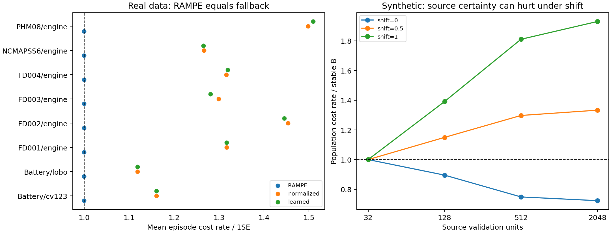
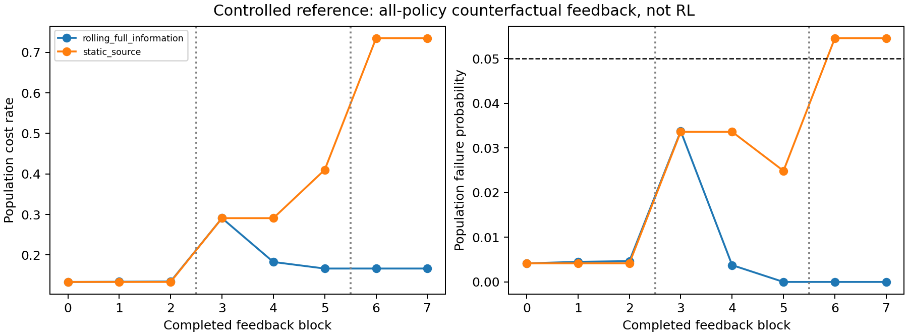

# RAMPE final scientific report

**Decision: D. NOT A CONTRIBUTION.**

**Did this project produce a genuinely new scientific contribution that can defensibly be attributed to this research? NO.**

This conclusion concerns the proposed new RAMPE/RL-RAMPE method. The work produced a reproducible negative investigation, not a defensible new methodological contribution. All previous CAT/CAT-c evidence remains frozen. No deployment safety guarantee is claimed.

## SECTION 1 — Scientific problem discovered

Estimated policy performance, selection sensitivity and future deployment reliability differ. A low observed renewal cost may arise from missing rare failures, favorable validation regimes, or unstable authority selection. The intended problem is to allocate a whole maintenance policy using evidence about both economics and reliability. Real preventive maintenance also changes which future outcomes can be observed; this prototype has retrospective completed-unit outcomes and does not model that feedback.

The experiment uses six engine datasets (PHM08, FD001–FD004, NCMAPSS6; 1026 original held-out units) and Battery (123 cells evaluated in CV and three batch holdouts). These repeated regimes do not create new independent cells. The bearing dataset lacks a comparable frozen four-policy cost pool and was excluded explicitly. No predictors or original policies were retrained. All new results live in `out/rampe`; all source is in `rampe`.

For each of 38 original outer groups, split held-out units into disjoint labelled meta-validation and meta-test halves using ten seeds 2026–2035. Validation size is 9–26. Four leads and four cost asymmetries yield **6080 retrospective episodes, 121600 outcomes for 20 methods**. This consumes additional labelled lives; it is not zero-label deployment transfer, the original benchmark, or ten new model-training runs. Each new selector receives the same validation labels. Query context is first observed operating regime/flight class or known battery batch; future life and test failure labels are not gate inputs.

## SECTION 2 — Why existing CAT/CAT-c cannot solve it

Frozen evidence already found established conformal mathematics, fragility improvement over plain tuning on 5/6 engine datasets, no demonstrated fragility advantage over 1-SE, and failed battery transfer. A single calibrated threshold does not identify conditional target shift or validate a new expert authority mechanism. The new gate does not fix calibration/refit dependence in the old method. Independently selecting among fixed candidates on new labelled validation units is a different, narrower protocol.

## SECTION 3 — RAMPE mathematical formulation

Pool Π={plain cost, CAT(.05), CAT-c(.05), 1-SE}; fallback=1-SE. For policy k and supported context g, estimate C=sum(cost)/sum(useful life), S=bootstrap co-optimal-set membership fraction, Q=one-sided binomial failure upper bound, T=observed context-support indicator, U=bootstrap cost-rate SD and D=leave-one-validation-unit co-optimal membership fraction. Use 100 paired unit bootstrap draws. T is a support flag, not an estimator of genuine transfer reliability. S and D measure perturbation sensitivity; they need not sum to one across policies.

Risk tolerance α=.05 and family error δ=.05 are fixed. Allocate δ/[K(G+1)] per local/pooled policy bound. Analytic R=min(α/Q,2S,2D) when supported, else zero. Eligibility requires Q≤α, S≥.5, D≥.5, T=1. Choose min(C+U) among eligible policies; if none, abstain and execute 1-SE. R is not a probability. The .5 majority threshold and one-SD penalty are conventions, not learned scientific constants.

Five formulations were tested: analytic conjunction; normalized min(1,α/Q)SD divided by C+U; standardized logistic empirical acceptability learned from other datasets; minimum C+U uncertainty-only routing; and mean rank of C,Q,−S,U,−D. Equal ranks and multiplied components are explicitly heuristics rather than unexplained probability models. Logistic C=1 and threshold .5 were fixed, with no test tuning. Both battery regimes are excluded when Battery is the held-out learned-gate domain.

Uniform, reliability, random Dirichlet and inverse-cost weighting sample **one complete policy per unit**. Incompatible alarm times are never averaged. Weights depending on context can exploit specialization; a fixed lottery cannot beat the best member's population renewal rate.

## SECTION 4 — Algorithm and pseudocode

```text
Freeze fitted policies, finite causal contexts, fallback and alpha/delta.
Separate completed meta-validation lives from untouched meta-test units.
For each query context:
    estimate paired cost/life ratios and bootstrap/jackknife sensitivity
    compute multiplicity-corrected binomial failure upper bounds
    exclude unsupported or risk/stability-ineligible policies
    if any eligible: assign whole-policy authority minimizing cost + SD
    otherwise: record ABSTAIN and assign fallback authority
Evaluate outcomes only after authorities have been assigned.
```

Executable definitions: [core.py](core.py), [real.py](real.py). Protocol: [PLAN.md](PLAN.md). Independent baseline outcomes are preserved, not recomputed under new policy settings.

## SECTION 5 — RL-RAMPE assessment

RL was not justified for independent retrospective unit arbitration: no demonstrated action-dependent transition state or sequential real feedback exists. One decision with later selected-action feedback would first be a contextual bandit; variable renewal durations call for renewal/semi-Markov accounting. A real maintenance MDP/POMDP needs verified degradation transitions and action effects.

A controlled sequential reference was implemented with static source evidence versus rolling last-512-unit evidence, eight blocks of 256 units, 30 seeds, 18 methods, **8640 outcomes**. All policies' completed counterfactual outcomes become available only after each block. This is full-information updating, not a contextual-bandit or RL experiment. PPO, bandits and RL-RAMPE were not run or claimed validated. Temporal blocks shift failure distributions after block 2 and block 5; costs change from 50 to 100 at block 5. Block order is synthetic, not an invented chronology for the real datasets.

## SECTION 6 — Theoretical analysis

[THEORY.md](THEORY.md) proves three standard propositions and one index lemma, with explicit assumptions: simultaneous accepted-policy conditional failure control; uniform-estimation excess rate ≤2ε+oracle penalty inside the selected subset; fixed-lottery convexity of renewal rates; and the equivalence of the analytic index to its constraints. Ratio concentration requires known cost/life bounds and independent units. Bootstrap SD is not claimed as a finite-sample guarantee.

The accepted-policy property excludes an uncertified fallback. With zero failures, minimum local sample size is ceil(log(d)/log(.95)); even the least fragmented K=4 case needs 99 validation units. Actual total sizes are at most 26. Consequently every real gate abstains; this was retained rather than relaxing risk thresholds after observing results.

A counterexample shows that minimizing each context's cost/life ratio can be globally wrong: two equally likely contexts give greedy global rate .55 versus alternative 21/110≈.190909. The synthetic population oracle therefore optimizes the global fractional objective. This is an established fractional-control phenomenon, not a new theorem. Arbitrary hidden conditional shift is unidentifiable from unchanged source data and query contexts. No universal transfer bound or fallback safety theorem was obtained.

## SECTION 7 — Experimental results

Mean episode renewal cost rates across all leads/costs/partition seeds:

| dataset | analysis | 1SE | CAT | CATc | RAMPE | conventional | learned | normalized | plain |
| --- | --- | --- | --- | --- | --- | --- | --- | --- | --- |
| Battery | cv123 | 0.00146855 | 0.00170519 | 0.00147001 | 0.00146855 | 0.00168703 | 0.00170506 | 0.00170483 | 0.00153073 |
| Battery | lobo | 0.00245872 | 0.01137 | 0.00622766 | 0.00245872 | 0.00275015 | 0.00275015 | 0.00275015 | 0.00605945 |
| FD001 | engine | 0.00523197 | 0.00718724 | 0.00538756 | 0.00523197 | 0.00689095 | 0.0068908 | 0.006891 | 0.00582648 |
| FD002 | engine | 0.00540888 | 0.00872134 | 0.00550605 | 0.00540888 | 0.00648732 | 0.00781512 | 0.00785933 | 0.00581704 |
| FD003 | engine | 0.00450334 | 0.00666864 | 0.0052221 | 0.00450334 | 0.00585214 | 0.00577003 | 0.00585208 | 0.00494905 |
| FD004 | engine | 0.00478657 | 0.0067518 | 0.00468326 | 0.00478657 | 0.00583851 | 0.00631433 | 0.00630018 | 0.0050744 |
| NCMAPSS6 | engine | 0.0205613 | 0.0256809 | 0.0204997 | 0.0205613 | 0.0261015 | 0.0260176 | 0.0260395 | 0.0203665 |
| PHM08 | engine | 0.00513941 | 0.00836333 | 0.00564913 | 0.00513941 | 0.00685066 | 0.00775828 | 0.00769978 | 0.00611605 |


RAMPE and 1-SE have identical selected policy, unit costs, useful lives and failure labels in all 6080 episodes. Thus any gain against conventional pooled minimum cost is entirely inherited from 1-SE; it is not evidence that the reliability gate adds value. Learned and normalized gates are worse than RAMPE/1-SE on these aggregate rates. All 20 methods and setting-level results are retained in [real_summary.csv](../out/rampe/real_summary.csv) and [real_setting_summary.csv](../out/rampe/real_setting_summary.csv).

Failure probability and abstention:

| dataset | analysis | method | risk_mean | abstention_mean |
| --- | --- | --- | --- | --- |
| Battery | cv123 | RAMPE | 0.00153846 | 1 |
| Battery | cv123 | conventional | 0.0123718 | 0 |
| Battery | cv123 | learned | 0.0133333 | 0 |
| Battery | cv123 | normalized | 0.0133333 | 0 |
| Battery | lobo | RAMPE | 0.0215909 | 1 |
| Battery | lobo | conventional | 0.032197 | 0 |
| Battery | lobo | learned | 0.032197 | 0 |
| Battery | lobo | normalized | 0.032197 | 0 |
| FD001 | engine | RAMPE | 0 | 1 |
| FD001 | engine | conventional | 0.0185 | 0 |
| FD001 | engine | learned | 0.0185 | 0 |
| FD001 | engine | normalized | 0.0185 | 0 |
| FD002 | engine | RAMPE | 0.00211538 | 1 |
| FD002 | engine | conventional | 0.0138462 | 0 |
| FD002 | engine | learned | 0.0271154 | 0 |
| FD002 | engine | normalized | 0.0275 | 0.0115385 |
| FD003 | engine | RAMPE | 0 | 1 |
| FD003 | engine | conventional | 0.0185 | 0 |
| FD003 | engine | learned | 0.0175 | 0 |
| FD003 | engine | normalized | 0.0185 | 0 |
| FD004 | engine | RAMPE | 0.0044 | 1 |
| FD004 | engine | conventional | 0.0179 | 0 |
| FD004 | engine | learned | 0.024 | 0 |
| FD004 | engine | normalized | 0.0238 | 0.0264 |
| NCMAPSS6 | engine | RAMPE | 0.00475 | 1 |
| NCMAPSS6 | engine | conventional | 0.026625 | 0 |
| NCMAPSS6 | engine | learned | 0.027375 | 0 |
| NCMAPSS6 | engine | normalized | 0.027375 | 0.022 |
| PHM08 | engine | RAMPE | 0.000909091 | 1 |
| PHM08 | engine | conventional | 0.0186364 | 0 |
| PHM08 | engine | learned | 0.0279545 | 0 |
| PHM08 | engine | normalized | 0.0272727 | 0.0145455 |


The failure metric is the existing unplanned-failure label, not documented catastrophic severity. Median, observed maximum and variance concern per-unit accounting costs, which equal 1 or rho. Maxima are observed maxima, not population worst-case bounds. Renewal cost rate is the primary economic estimand, distinct from mean accounting cost or mean unit rate.



## SECTION 8 — Ablation results

Equal-weight mean over eight real evaluation regimes (not a pooled renewal rate):

| method | cost_rate_mean | risk_mean | abstention_mean |
| --- | --- | --- | --- |
| 1SE | 0.00619484 | 0.00441298 | 0 |
| CAT | 0.00955606 | 0.0606132 | 0 |
| CATc | 0.00683069 | 0.0197963 | 0 |
| RAMPE | 0.00619484 | 0.00441298 | 1 |
| RAMPE_no_abstention | 0.00812767 | 0.0234969 | 0 |
| RAMPE_no_calibration | 0.00801995 | 0.0224181 | 0.0531075 |
| RAMPE_no_context | 0.00619484 | 0.00441298 | 1 |
| RAMPE_no_reliability | 0.00813293 | 0.0235607 | 0 |
| RAMPE_no_stability | 0.00619484 | 0.00441298 | 1 |
| RAMPE_no_transfer | 0.00619484 | 0.00441298 | 1 |
| conventional | 0.00780728 | 0.019822 | 0 |
| cost_weights | 0.00712675 | 0.0212209 | 0 |
| learned | 0.00812767 | 0.0234969 | 0 |
| normalized | 0.0081371 | 0.0235598 | 0.00931049 |
| plain | 0.00696746 | 0.0235348 | 0 |
| random_weights | 0.00759372 | 0.0288698 | 0 |
| rank | 0.00813662 | 0.0235891 | 0 |
| reliability_ensemble | 0.00816826 | 0.0237807 | 0 |
| uncertainty | 0.00812767 | 0.0234969 | 0 |
| uniform_ensemble | 0.00741968 | 0.0280233 | 0 |


Calibration eligibility is the binding bottleneck. Removing bootstrap stability, transfer veto or context does not make the small samples certifiable; unchanged outcomes do not prove those components are irrelevant in general. Removing calibration or abstention exposes the more aggressive authority choices. Removing all reliability uses local minimum cost; conventional uses pooled minimum cost. The no-stability variant removes S while retaining jackknife D, so it is a specific component removal, not removal of every perturbation signal. Random/inverse-cost lotteries and every synthetic ablation remain in the output tables.

Partition authority fragility (one minus largest majority-policy frequency over ten seeds):

| method | partition_authority_fragility |
| --- | --- |
| 1SE | 0 |
| CAT | 0 |
| CATc | 0 |
| RAMPE | 0 |
| RAMPE_no_abstention | 0.119737 |
| RAMPE_no_calibration | 0.131908 |
| RAMPE_no_context | 0 |
| RAMPE_no_reliability | 0.120559 |
| RAMPE_no_stability | 0 |
| RAMPE_no_transfer | 0 |
| conventional | 0.21727 |
| cost_weights | 0.576316 |
| learned | 0.119408 |
| normalized | 0.118586 |
| plain | 0 |
| random_weights | 0.560526 |
| rank | 0.121217 |
| reliability_ensemble | 0.115461 |
| uncertainty | 0.119737 |
| uniform_ensemble | 0.607895 |


This is a selection-sensitivity diagnostic with fixed fitted policies. It is not algorithmic-stability theory or predictor retraining fragility. Authority changes within sorted unit order are reported, but they are neither chronological nor within-life policy switching. Abstention avoided/introduced failures, false abstentions and accounting/life differences are ex-post paired diagnostics against conventional selection, not causal estimates of prevented catastrophes. No randomized real intervention occurred.

## SECTION 9 — Stress-test results

Validation stress completed **329080 method cases**: 328320 fraction/noise outcomes plus 760 support-removal outcomes. Fractions=.25,.5,1; additive cost-accounting noise SD=0,.1,1, with failure labels fixed. Noise is clipped to positive cost, introducing an acknowledged upward bias near zero; this is not sensor corruption. Mean RAMPE summaries across regimes/settings:

| fraction | accounting_noise_sd | cost_rate_mean | risk_mean | abstention_mean |
| --- | --- | --- | --- | --- |
| 0.25 | 0 | 0.00619484 | 0.00441298 | 1 |
| 0.25 | 0.1 | 0.00619484 | 0.00441298 | 1 |
| 0.25 | 1 | 0.00619484 | 0.00441298 | 1 |
| 0.5 | 0 | 0.00619484 | 0.00441298 | 1 |
| 0.5 | 0.1 | 0.00619484 | 0.00441298 | 1 |
| 0.5 | 1 | 0.00619484 | 0.00441298 | 1 |
| 1 | 0 | 0.00619484 | 0.00441298 | 1 |
| 1 | 0.1 | 0.00619484 | 0.00441298 | 1 |
| 1 | 1 | 0.00619484 | 0.00441298 | 1 |


Fixed-rule lead/cost shift completed **45600 method cases**. Freeze selection at lead 0/rho10. Actual frozen alarm-use outcomes are re-evaluated at four required lead times and rho=5,10,20,50,100. Failure occurs if originally failed or alarm-use+required-lead reaches/exceeds observed lifetime; failures consume full lifetime. No rule is retuned. Full results: [fixed_rule_shift_summary.csv](../out/rampe/fixed_rule_shift_summary.csv). Large lead may cause the fallback itself to fail; abstention does not protect against a universally inadequate pool.

All **247680** previous fixed-score stress rows were read and their original hash retained. They lack all candidate alarm/life trajectories and therefore cannot be relabelled as RAMPE cost experiments. Compatible fractions and seeds were reused; [legacy_stress_bridge.json](../out/rampe/legacy_stress_bridge.json) records the precise limit. Original results were not overwritten.

## SECTION 10 — Transfer and controlled mechanism results

The synthetic generator creates rare-event/variable-life A, stable preventive B, and regime-specialist C. A and C are not artificial additions to the real candidate pool: they are explicit toy outcome distributions requested to isolate the mechanism. Life SD parameters are 0/.6, n=32/128/512/2048, rho=10/50, accounting noise=0/1, source specialist prevalence=.1/.5/.9 and shift=0/.5/1, with 30 independent validation/test seeds per condition. **288 grid conditions =8640 episodes**, plus 60 attack episodes, giving **8700 episodes and 156600 method outcomes**. Each target episode contains 1000 units. Life and failure are independent in this toy generator; it is not a physically validated degradation simulator.

Source failure probabilities are A=.01, B=0, C=.15 outside specialist regime and 0 inside. Expected lives are 10,6 and 10/9. Shift increases target A and C failure probabilities and changes target regime prevalence without changing the available regime identifiers. Policy B's rate is 1/6. At large source n, matched-distribution arbitration improves over B and conventional selection, but hidden target shifts reverse that benefit:

| n_validation | shift | method | population_rate_mean | population_risk_mean | population_context_feasible_mean | abstention_mean |
| --- | --- | --- | --- | --- | --- | --- |
| 32 | 0 | B | 0.166667 | 0 | 1 | 0 |
| 32 | 0 | RAMPE | 0.166667 | 0 | 1 | 1 |
| 32 | 0 | conventional | 0.138502 | 0.0104722 | 0.9 | 0 |
| 32 | 0.5 | B | 0.166667 | 0 | 1 | 0 |
| 32 | 0.5 | RAMPE | 0.166667 | 0 | 1 | 1 |
| 32 | 0.5 | conventional | 0.224705 | 0.0423408 | 0.9 | 0 |
| 32 | 1 | B | 0.166667 | 0 | 1 | 0 |
| 32 | 1 | RAMPE | 0.166667 | 0 | 1 | 1 |
| 32 | 1 | conventional | 0.313745 | 0.0751532 | 0.144444 | 0 |
| 128 | 0 | B | 0.166667 | 0 | 1 | 0 |
| 128 | 0 | RAMPE | 0.149221 | 0.0017 | 1 | 0.600826 |
| 128 | 0 | conventional | 0.134433 | 0.00875694 | 0.918056 | 0 |
| 128 | 0.5 | B | 0.166667 | 0 | 1 | 0 |
| 128 | 0.5 | RAMPE | 0.19161 | 0.0142042 | 1 | 0.597832 |
| 128 | 0.5 | conventional | 0.212534 | 0.0402365 | 0.918056 | 0 |
| 128 | 1 | B | 0.166667 | 0 | 1 | 0 |
| 128 | 1 | RAMPE | 0.23188 | 0.025305 | 0.602778 | 0.621582 |
| 128 | 1 | conventional | 0.294438 | 0.0728224 | 0.165278 | 0 |
| 512 | 0 | B | 0.166667 | 0 | 1 | 0 |
| 512 | 0 | RAMPE | 0.12474 | 0.00545972 | 1 | 0.0983486 |
| 512 | 0 | conventional | 0.132204 | 0.00921528 | 0.959722 | 0 |
| 512 | 0.5 | B | 0.166667 | 0 | 1 | 0 |
| 512 | 0.5 | RAMPE | 0.216211 | 0.0353432 | 1 | 0.112143 |
| 512 | 0.5 | conventional | 0.225427 | 0.0443324 | 0.959722 | 0 |
| 512 | 1 | B | 0.166667 | 0 | 1 | 0 |
| 512 | 1 | RAMPE | 0.301757 | 0.0617004 | 0.0388889 | 0.156692 |
| 512 | 1 | conventional | 0.321036 | 0.0799932 | 0.0986111 | 0 |
| 2048 | 0 | B | 0.166667 | 0 | 1 | 0 |
| 2048 | 0 | RAMPE | 0.120553 | 0.00671528 | 1 | 0.0192708 |
| 2048 | 0 | conventional | 0.129074 | 0.00995833 | 1 | 0 |
| 2048 | 0.5 | B | 0.166667 | 0 | 1 | 0 |
| 2048 | 0.5 | RAMPE | 0.222149 | 0.041426 | 1 | 0.0157653 |
| 2048 | 0.5 | conventional | 0.244257 | 0.0497917 | 1 | 0 |
| 2048 | 1 | B | 0.166667 | 0 | 1 | 0 |
| 2048 | 1 | RAMPE | 0.321717 | 0.07484 | 0 | 0.0187069 |
| 2048 | 1 | conventional | 0.35944 | 0.089625 | 0.00416667 | 0 |


Context-feasible fraction requires every assigned positive-probability policy to have true conditional failure probability ≤.05. A low marginal rate or negative cost excess against the constrained oracle does not imply an admissible policy; report feasibility alongside “regret”. Oracle disagreement is true population-context authority error against the fractional safe oracle, not model-classification accuracy. [uncertain_best_policy.csv](../out/rampe/uncertain_best_policy.csv) stratifies cases by resampling uncertainty in the identity of the best source policy. Uncertain winner identity alone does not establish better target arbitration.

Failure attacks:

| attack | method | population_rate_mean | population_risk_mean | abstention_mean |
| --- | --- | --- | --- | --- |
| known_all_fail | B | 8.33333 | 1 | 0 |
| known_all_fail | RAMPE | 8.33333 | 1 | 1 |
| known_all_fail | RAMPE_no_transfer | 8.33333 | 1 | 1 |
| known_all_fail | conventional | 5.03509 | 1 | 0 |
| unseen_regime | B | 0.166667 | 0 | 0 |
| unseen_regime | RAMPE | 0.166667 | 0 | 1 |
| unseen_regime | RAMPE_no_transfer | 2.521 | 0.49 | 0 |
| unseen_regime | conventional | 2.521 | 0.49 | 0 |


An unseen-regime veto works only by assuming the stable B fallback remains valid. When all policies fail, RAMPE abstains but still fails with probability one. Removing the transfer veto can select source-qualified policies in the unseen context and fail badly. Real support removal is a signal intervention with unchanged outcomes, not newly generated real sensor regimes.

Cross-dataset transfer applies only to the learned gate: its training excludes every row of the held-out dataset, including both battery CV and LOBO together. It does not transfer or refit base health predictors. Learned acceptability calibration (empirical target-rate≤1-SE and failure≤.05 label, **not** failure probability calibration):

| dataset | rows | acceptability_brier | acceptability_ece | mean_probability | empirical_acceptability |
| --- | --- | --- | --- | --- | --- |
| Battery | 11520 | 0.113431 | 0.0289575 | 0.847547 | 0.874566 |
| FD001 | 3200 | 0.118578 | 0.0328161 | 0.898552 | 0.866875 |
| FD002 | 18944 | 0.121181 | 0.0223718 | 0.838407 | 0.860061 |
| FD003 | 3200 | 0.103757 | 0.055292 | 0.889116 | 0.885625 |
| FD004 | 18688 | 0.117491 | 0.0294564 | 0.842982 | 0.865582 |
| NCMAPSS6 | 9408 | 0.178537 | 0.104508 | 0.877903 | 0.784439 |
| PHM08 | 19072 | 0.144175 | 0.0412593 | 0.854943 | 0.82781 |


Other gates report holdout failure rate minus mean selected validation empirical risk; this is a calibration-gap diagnostic, not probability ECE. Quantities derived from repeated cells are descriptive. Genuine target conditional-risk calibration remained unestablished.

Controlled temporal reference:

| feedback | block | shift | rho | population_rate_mean | population_risk_mean | abstention_mean |
| --- | --- | --- | --- | --- | --- | --- |
| rolling_full_information | 0 | 0 | 50 | 0.1336 | 0.00416667 | 0.0154948 |
| rolling_full_information | 1 | 0 | 50 | 0.134123 | 0.0045 | 0 |
| rolling_full_information | 2 | 0 | 50 | 0.134721 | 0.00466667 | 0.0157552 |
| rolling_full_information | 3 | 0.5 | 50 | 0.290993 | 0.0337833 | 0.0122396 |
| rolling_full_information | 4 | 0.5 | 50 | 0.182864 | 0.00376667 | 0.0665365 |
| rolling_full_information | 5 | 0.5 | 100 | 0.166667 | 0 | 0 |
| rolling_full_information | 6 | 1 | 100 | 0.166667 | 0 | 0 |
| rolling_full_information | 7 | 1 | 100 | 0.166667 | 0 | 0 |
| static_source | 0 | 0 | 50 | 0.1336 | 0.00416667 | 0.0154948 |
| static_source | 1 | 0 | 50 | 0.1336 | 0.00416667 | 0.0153646 |
| static_source | 2 | 0 | 50 | 0.1336 | 0.00416667 | 0.0154948 |
| static_source | 3 | 0.5 | 50 | 0.291013 | 0.0336333 | 0.0122396 |
| static_source | 4 | 0.5 | 50 | 0.291013 | 0.0336333 | 0.0126302 |
| static_source | 5 | 0.5 | 100 | 0.410302 | 0.0248833 | 0 |
| static_source | 6 | 1 | 100 | 0.735048 | 0.0546 | 0 |
| static_source | 7 | 1 | 100 | 0.735048 | 0.0546 | 0 |


Rolling completed counterfactual evidence can adapt after a shift; the first shifted block cannot benefit from unobserved future feedback. This shows the value of new information, not a new RL method. New full outcomes cannot be assumed available after real preventive interventions.



## SECTION 11 — Statistical analysis

All method summaries include mean, SD, median, observed min/max. [real_paired_descriptive.csv](../out/rampe/real_paired_descriptive.csv) records paired rate effects, relative effects and win/tie/loss across all episodes. These 6080 episodes reuse units and fitted models; they are **not 6080 independent studies**. No significance test treats partition seeds or leads as independent samples.

Conditional real inference uses one partition seed (2026) and 2000 paired unit-bootstrap draws (seed2027), giving **768** cost intervals. It conditions on frozen fitted rules and selected authorities and omits re-selection/retraining uncertainty. CV/shared-source dependence restricts interpretation; intervals do not establish deployment generalization. Selected interval envelopes across all 16 settings are shown below; they are not simultaneous confidence intervals:

| dataset | analysis | baseline | mean_rate_difference | minimum_interval_low | maximum_interval_high |
| --- | --- | --- | --- | --- | --- |
| Battery | cv123 | 1SE | 0 | 0 | 0 |
| Battery | cv123 | CATc | -6.7198e-05 | -0.00338097 | 0.000114953 |
| Battery | cv123 | conventional | -0.000323442 | -0.00518628 | 0.000390206 |
| Battery | lobo | 1SE | 0 | 0 | 0 |
| Battery | lobo | CATc | -0.00297903 | -0.0168578 | 3.85678e-06 |
| Battery | lobo | conventional | -4.35346e-05 | -0.00334603 | 0.000276774 |
| FD001 | engine | 1SE | 0 | 0 | 0 |
| FD001 | engine | CATc | 5.12283e-05 | -2.87824e-05 | 0.000122149 |
| FD001 | engine | conventional | -0.00195778 | -0.0334783 | 0.000248469 |
| FD002 | engine | 1SE | 0 | 0 | 0 |
| FD002 | engine | CATc | -2.40599e-05 | -0.00610045 | 0.00598838 |
| FD002 | engine | conventional | -0.00208383 | -0.019224 | 0.0039373 |
| FD003 | engine | 1SE | 0 | 0 | 0 |
| FD003 | engine | CATc | 0.000108883 | 2.49883e-05 | 0.000172467 |
| FD003 | engine | conventional | -0.000248604 | -0.0122886 | 0.000234738 |
| FD004 | engine | 1SE | 0 | 0 | 0 |
| FD004 | engine | CATc | 1.61672e-05 | -4.27871e-05 | 0.000119894 |
| FD004 | engine | conventional | -0.00137592 | -0.015934 | 0.000148057 |
| NCMAPSS6 | engine | 1SE | 0 | 0 | 0 |
| NCMAPSS6 | engine | CATc | -0.000703992 | -0.0594785 | 0.0561943 |
| NCMAPSS6 | engine | conventional | -0.00789433 | -0.0852226 | 0.0387333 |
| PHM08 | engine | 1SE | 0 | 0 | 0 |
| PHM08 | engine | CATc | -0.000470838 | -0.00697377 | 2.85235e-05 |
| PHM08 | engine | conventional | -0.00151167 | -0.0149522 | 8.17958e-05 |


RAMPE versus 1-SE has point difference 0 and interval [0,0] because actions are identical; this proves equality in recorded outcomes, not universal population equivalence. Battery LOBO uses disjoint test batches, one seed only, exact paired binary sign/McNemar tests and Holm correction across **96** comparisons. Their exchangeability assumptions remain conditional on source fits. All raw and adjusted p-values are retained, including nonsignificant results.

Synthetic paired inference concerns independent **simulator validation cohorts**, not real-engine deployments. For each 30-seed condition, paired population-rate differences have mean/SD/median, relative effects, Student-t mean intervals (approximate), and exact nonzero-sign tests. Holm is applied across **580** comparisons including attacks; it controls this sign-testing family, not every descriptive metric or interval. Aggregated counts for nonattack conditions:

| shift | baseline | conditions | significant_Holm | wins | ties | losses |
| --- | --- | --- | --- | --- | --- | --- |
| 0 | B | 96 | 56 | 1698 | 1182 | 0 |
| 0 | conventional | 96 | 75 | 720 | 522 | 1638 |
| 0.5 | B | 96 | 56 | 841 | 1182 | 857 |
| 0.5 | conventional | 96 | 62 | 1394 | 522 | 964 |
| 1 | B | 96 | 56 | 0 | 1182 | 1698 |
| 1 | conventional | 96 | 79 | 2283 | 522 | 75 |


The sign test tests directional consistency (under iid simulator draws), not a null of equal mean. Ties are removed from its denominator. Monte Carlo confidence does not validate the simulator's physical assumptions. Full condition-level results, including loses and ties, are in [synthetic_paired_tests.csv](../out/rampe/synthetic_paired_tests.csv).

## SECTION 12 — Literature overlap table

The complete table with title, year, venue, problem, method/mathematics, similarity, difference and claim-invalidating assessment is [LITERATURE_AUDIT.md](LITERATURE_AUDIT.md). It includes 27 close/relevant papers across local experts, DES/meta-learning, streaming arbitration/abstention, cost-sensitive deferral, conformal testing, stability, robust optimization/domain generalization, safe contextual bandits, renewal control and maintenance/meta-RL. Reading depth and version differences are explicit.

Closest overlaps: [META-DES](https://arxiv.org/pdf/1810.01270) for multi-evidence learned competence; [streaming ADE](https://project.inria.fr/aaltd19/files/2019/08/AALTD_19_Boutegane.pdf) for uncertainty about competence plus adaptive abstention; [multi-expert deferral](https://proceedings.mlr.press/v206/verma23a/verma23a.pdf) for calibrated expert authority; [LTT](https://arxiv.org/html/2110.01052v5) for risk-screened utility selection; and [renewal bandits](https://www.atillaeryilmaz.com/RenewalBanditsSigmetrics2020.pdf) for rates, interrupted/truncated feedback and confidence-aware sequential control. No paper is claimed to contain the exact numerical six-feature recipe; that recipe is an unvalidated combination, not demonstrated conceptual novelty.

## SECTION 13 — Novelty attack

All six strict gates fail for the implemented claim. A: contextual competence allocation is established. B: CP screening, bootstrap/jackknife sensitivity and uncertainty penalties are established ingredients. C: gating, weighting and fallback are established mechanisms. D: a constrained cost-sensitive dynamic expert selector can reproduce the architecture. E: real authority always stays at the existing baseline; toy gains do not isolate a new contribution. F: close methods already address reliability-sensitive expert/policy authority, including confidence in meta-reliability itself.

Failure conditions were observed or identified: insufficient rare-failure evidence; unseen contexts; hidden conditional shift despite supported context; all-policy failure; correlated near-identical candidate outcomes; unreliable learned competence; nonexistent transfer signal; excessive abstention; local/global renewal objective mismatch; and unavailable counterfactual feedback. Removing context when no meaningful specialization exists cannot create information. Larger source samples can amplify confident wrong deployment under unidentified shift. CAT+ensemble, CAT+PPO, revised weights and a new name are rejected as novelty rescues.

## SECTION 14 — Final novelty verdict

**D. NOT A CONTRIBUTION. NO genuinely new scientific contribution is established.** Novelty fails and meaningful incremental real-data advantage over 1-SE is absent. This is not C: the synthetic matched-regime gains do not make RAMPE broadly empirically strong against its strongest real baseline and shift tests. It is not B: the implemented mechanism is not a sufficiently distinct promising new idea awaiting only more evidence.

Useful negative evidence and software were produced, but their first-in-literature originality, publication suitability and deployment validity were not established. This verdict applies to RAMPE and the requested novelty claim, not to the value of carefully preserving the earlier study.

## SECTION 15 — Exact contribution statement

Defensible statement: “We implemented and audited reliability-sensitive arbitration among four frozen maintenance policies. Under a labelled retrospective meta-validation protocol, corrected risk eligibility forced fallback in every real evaluation; alternative heuristic/learned gates did not establish an advantage over 1-SE. Controlled tests showed matched-regime selection gains and hidden-shift failures, and prior art prevented attributing the architecture as a new method.” This is an empirical audit statement, not a claim of new conformal, ensemble or RL methodology.

The minimum **meaningful** conceptual change is an operational, identifiable problem with policy-induced censored/delayed feedback, paid inspections, random renewal durations and a coupled conditional-safety/rate objective. A new estimator, impossibility result or nontrivial safety–regret–inspection tradeoff must address a precise limitation of existing renewal-bandit, safe-deferral and maintenance-POMDP methods. Adding those terms alone does not guarantee novelty. Current data do not establish that new problem or solution.

## SECTION 16 — Recommended paper title

**When Reliability Gates Only Reproduce the Baseline: An Audit of Maintenance Policy Arbitration**

This is a title for a transparent empirical/negative study, subject to further publication-quality validation. A title asserting novel RAMPE or RL-RAMPE is not supported.

## SECTION 17 — Abstract

Maintenance policy tuning often conflates estimated performance with reliable decision authority. We investigate retrospective reliability-sensitive arbitration among plain cost tuning, conformal risk-controlled tuning, a stability-oriented variant and the one-standard-error baseline. Evidence combines renewal cost, resampling sensitivity, multiplicity-corrected failure bounds, context support and uncertainty. Five reliability formulations and policy-level lotteries are evaluated without averaging incompatible maintenance decisions. Across six engine benchmarks and two battery evaluation regimes, 6080 labelled meta-validation episodes produce universal abstention for the analytical gate and exact reproduction of the one-standard-error fallback. Learned and normalized alternatives do not establish an aggregate economic advantage. Controlled synthetic experiments show that contextual selection can help under matched distributions but becomes confidently inferior under hidden conditional shifts as source sample size grows. A temporal reference adapts using completed counterfactual outcomes, whose availability exceeds real preventive-maintenance feedback. Standard conditional-risk properties exclude uncertified fallback and unidentified transfer. A two-round literature audit identifies substantial overlap with dynamic ensemble selection, confidence-aware abstention, calibrated multi-expert deferral and renewal-policy bandits. We therefore reject a new-method contribution and provide reproducible negative evidence separating fallback performance, source confidence and operational transfer reliability.

## SECTION 18 — Three to five defensible outputs

1. A preserved-data, executable comparison of five reliability formulations, four whole-policy lotteries and component removals across every compatible frozen evaluation setting.
2. An explicit attribution check showing every analytical real-data result is inherited from the 1-SE fallback, with no incremental authority change.
3. Controlled sample-size, uncertainty, context, conditional-shift and all-policy-failure tests, plus an honestly scoped full-information temporal reference.
4. Standard proofs and counterexamples separating accepted-policy risk, fallback behavior and local versus global renewal optimization.
5. A primary-source prior-art and strict novelty audit rejecting an unsupported new-method claim.

These are project outputs; none is asserted here to be a first-in-literature methodological contribution.

## SECTION 19 — Anticipated reviewer objections

“The gate cannot certify with these sample sizes.” Correct; this is a decisive negative result, not evidence that abstention magically protects deployment. “Additional validation labels change the benchmark.” Correct; baseline rules are frozen and the retrospective information budget is explicit. “Repeated seeds are pseudo-replication.” Correct; descriptive repetitions and conditional inference are distinguished. “The learner sees the target labels.” It sees other-dataset empirical labels for training; the held-out dataset is excluded, and target outcomes are evaluated after choice. Correlated training rows and domain mismatch still limit interpretation.

“Context support is not transfer reliability.” Correct and demonstrated by hidden conditional shift. “A/B/C are unrealistic.” They isolate a requested mechanism; life/failure independence and outcome-only generation preclude deployment claims. “The oracle objective differs from local selection.” Correct; a counterexample and fractional oracle expose that limitation. “Your ensemble/RL architecture already exists.” Correct; novelty is rejected. “Catastrophic failures were not measured.” Only frozen unplanned-failure proxies exist. “No bandit/RL comparisons were run.” They were not justified by available real feedback; the temporal reference is clearly full-information and no RL performance is claimed.

## SECTION 20 — Recommended next experiments

Before further algorithmic branding, collect or simulate a physically justified operational feedback process with logged authority propensities, preventive intervention/censoring, delayed failures, replacement durations and inspection actions. Define identifiability assumptions and target conditional safety. Compare simple context cost routing, globally coupled fractional routing, established cost-sensitive deferral, safe contextual/renewal bandits and a maintenance POMDP where actions change state. Use fresh independent chronological source/calibration/test cohorts, enough effective units to estimate rare failures, and multiple genuinely retrained predictors when that is the estimand. Evaluate policy disagreement, inspection information value, censoring bias, safety violations and total renewal economics with a prespecified inferential family. Audit the exact resulting math against renewal-bandit and censored-control prior work before making a novelty claim. Do not promise that more seeds or weights will rescue current RAMPE.

Reproduction instructions: [README.md](README.md). Integrity and scope: [verification.json](../out/rampe/verification.json) and [run_manifest.json](../out/rampe/run_manifest.json). The original 31488 battery decisions, 247680 score-stress cases and previous verification artifacts remain unchanged.
