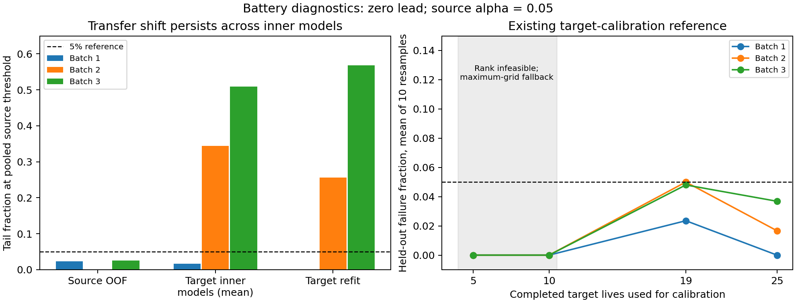

# Scientific completion report: CAT, conservatism and transfer

Completed 8 October 2026, Asia/Dhaka. This is a post hoc investigation of frozen results, with new diagnostics isolated in `research_next/` and `out/research_next/`.

**Verdict: no defensible novel methodological contribution has been established.** CAT/CAT-c provides a useful operational formulation and reproducible empirical evidence, but neither the frozen method nor the investigated generic extensions meets the requested standard for a new ML algorithm. This is a negative novelty finding, not proof that no future method is possible. The strongest honest current contribution is an empirical and methodological audit of conservative maintenance tuning: its confounded comparisons, transfer failure, feasibility limits and gaps between calibration mathematics and deployment.

The investigation follows the request's explicit fallback when no genuinely novel method can be justified. No invented optimizer, improvement, ablation or theorem is supplied. New-method implementation and component-removal experiments were conditional on an eligible mechanism; that gate was not passed. The diagnostics, reference calculations, statistical audit and final pitch below are implemented and completed.

## Completion ledger for all ten requested phases

| Phase | What was completed | Scientific status |
| --- | --- | --- |
| 1: audit | Full source inventory/AST parse, complete frozen CSV parsing, mechanism reconstruction, paired operational effects and setting-confounding audit | Complete investigation; reading depth documented below |
| 2: novelty gap | All seven suggested families evaluated; three concrete directions ranked | No candidate qualifies yet |
| 3: method design | Explicit candidate objectives, parameter meanings and reference selection pseudocode examined | Generic designs rejected as novel methods; no selected new algorithm |
| 4: theory | Deterministic mechanics, rank validity, bootstrap counterexample, renewal contrast and concentration reference, transfer identifiability | Complete; standard results and unverified assumptions distinguished |
| 5: implementation | Isolated battery replay, calibration/reference utilities, stress and paired-statistics modules; 11 unit-test groups | Complete diagnostic implementation; no new optimizer claimed |
| 6: ablation | Existing CAT/alpha/setting/Bonferroni variants analyzed; matched-component future design specified | Existing comparisons completed; new-method removal runs inapplicable because no eligible method |
| 7: stress | 247,680 fixed-signal calibration/score cases; three batch holdouts; target-label budget reference; fixed-policy cost-matrix stress | Complete specified diagnostic grid; no raw-sensor, fresh model-seed, training-imbalance or chronological-stream claim |
| 8: statistics | All six engines, both battery regimes, fold summaries, paired effects, conditional cost intervals, 96 paired risk tests with Holm | Complete diagnostic validation; dependence/rare-event limits explicit |
| 9: literature | Primary-source mechanism audit, version-specific comparisons, abstract-only limitations | Targeted audit complete; no exhaustive/priority claim |
| 10: pitch | All 16 requested items, including honest title and exactly 150-word statement | Complete negative-gate pitch and future research criteria |

The earlier phases 0–3 remain complete with their 262 passing checks. That historical status is distinct from this ten-phase investigation and is preserved, not relabelled as ten completed new-method experiments.

## Phase 1: current scientific contribution, A–E

### A. Current contribution and exact mechanism

The operational object is a complete run-to-failure unit. A causal remaining-life regressor, smoothing span and debounce count produce the first alarm at a threshold. Lead time and permitted decision times determine whether replacement occurs strictly before failure. The trajectory critical score is the lowest finite-grid threshold producing timely replacement. Failure at threshold tau is exactly the event that this score exceeds tau, for a fixed complete prediction/alarm rule.

For unit i and candidate theta=(cap, span, debounce, tau), let F_i(theta) indicate unplanned failure. With preventive cost 1 and corrective cost rho, C_i(theta)=1+(rho-1)F_i(theta). Useful life T_i(theta) is replacement time plus lead for timely replacement, and full lifetime otherwise. The training renewal-rate estimate is

    Rhat(theta) = sum_i C_i(theta) / sum_i T_i(theta).

This is a ratio of sums, not the mean of per-unit ratios. Earlier alarms reduce failure exposure but can discard useful life; lower failure frequency does not guarantee lower renewal cost.

**Plain cost tuning** chooses the minimum Rhat over 36 alarm settings (3 caps, 3 spans and 4 debounce counts) and 60 thresholds: 2,160 candidates. Engine thresholds are 1–60 cycles; battery thresholds are 3–180 cycles. Training units are predicted out of fold, then the predictor is refitted on all outer training units for deployment. All preprocessing and model choices use the original protocols. Some source docstrings still say 27 settings; the executable constants give 36.

**1-SE tuning** first finds that same cost minimizer. It resamples complete training units 200 times, using seed 2026+fold/split index, and estimates the bootstrap SD of the winner's renewal rate (NumPy `std`, ddof=0). It retains every candidate with Rhat <= minimum Rhat + that SD. Among these it chooses the largest mean true remaining life at the alarm, treating missing alarms as zero; ties favor lower Rhat, then larger key/column through Python tuple ordering. These are training labels only. The multiplier is fixed at one, but the margin is already data- and cost-dependent. It is incorrect to describe this implementation as a fixed amount of conservatism or as merely a constant threshold.

**Bare CAT-CF** uses the window-tuned setting at H=20 cycles for engines, H=60 cycles for batteries. It takes the ceil((n+1)(1-alpha)) order statistic of that setting's critical scores. If the rank or finite threshold is unavailable, it uses the largest grid threshold and records a false finite-feasibility flag. The primary alpha is .05. Its main mathematical construction is established conformal calibration, not a new guarantee.

The window stage maximizes the training count of first alarms whose prediction error lies in the protocol window, with the original small absolute-shift penalty (.001 times shift magnitude for engines; physical-cycle scaling for batteries). Caps below H+20 engine cycles, or H+60 battery cycles, are excluded. CAT retains cap/span/debounce from this stage and calibrates its own threshold instead of carrying over the selected window shift. Thus bare CAT optimizes a calibration threshold conditional on a window-selected rule; it does not jointly minimize full-grid cost.

**CAT-c** retains the same setting and chooses the lowest training renewal rate among grid thresholds at least as large as the bare-CAT threshold. Ties favor the smaller threshold. Thus it can only alarm earlier than bare CAT for the same trajectory. The name does not imply a deployment risk certificate. Frozen CF calibration and refitted deployment scores are not an exact split-conformal construction.

**Fragility** is the count of outer-fold × lead × cost cells containing at least one test failure. Each engine has 5×4×4=80 such cells. It is neither bootstrap selection variance nor a measured property across independent training seeds. Even under iid fixed-policy risk p, the probability of any failure among n units is 1-(1-p)^n; cell size affects this metric. Battery CV and three-batch transfer use different cell counts and should not be directly compared as normalized stability estimates.

**Why the empirical comparison behaves this way:** CAT-c's upward threshold moves make replacement earlier and rescue bare-CAT failures. Against plain cost, its threshold constraint and different window-selected settings together reduce failure-containing cells on five engines; the outputs do not isolate their causal contributions. Against 1-SE, much of this advantage disappears because 1-SE already trades a data-dependent cost margin for earlier notice while searching more settings. The observed failure/cost/notice differences support this explanation, but the frozen single-seed design cannot establish a general instability mechanism or prove which setting change caused the benefit.

### B. Current limitations

1. The calibration theorem is inherited. The implementation's selection/calibration reuse and OOF-to-refit change prevent simply transferring its assumptions to the frozen deployment procedure.
2. CAT constrains thresholds at a window-selected setting; plain and 1-SE search the entire setting grid. Their comparison mixes predictor cap, smoothing/debounce and threshold conservatism.
3. The fragility metric does not estimate algorithmic or selection instability. A variance penalty aimed at that interpretation would address an unmeasured quantity.
4. CAT-c does not beat 1-SE on the pre-specified fragility comparison. It also has heterogeneous cost results, including negative results.
5. Three held-out battery batches are evidence of batch-specific failure, not a sufficient environment population or an operational feedback stream.
6. Pooled CV binomial screens, conditional bootstrap intervals and reused cost cells cannot establish independent repeated-run inference. Rare failures can make empirical bootstrap intervals overconfident.
7. Existing data are complete run-to-failure trajectories. Policy intervention, censoring, delayed labels and feedback collection are not validated by this offline setup.

### C. Most important unexplained phenomenon

The strongest signal is **why source-trained CAT-c and 1-SE behave very differently on battery batch 2, while CAT-c rescues bare CAT on batch 3**. At zero lead and rho=10:

| Held-out batch | Cells | CAT failures | CAT-c failures | Plain failures | 1-SE failures |
| --- | --- | --- | --- | --- | --- |
| 1 | 36 | 0 | 0 | 0 | 0 |
| 2 | 43 | 11 | 11 | 10 | 1 |
| 3 | 44 | 25 | 3 | 4 | 3 |

These are illustrative pre-existing slices; all four leads and four costs are retained in `battery_by_batch.csv`. Batch 2's source-window setting is (180,1,5); both plain and 1-SE choose (180,3,2), with thresholds 24 and 54 cycles respectively. CAT and CAT-c both use 36 cycles there. Therefore 1-SE's advantage cannot be assigned solely to its conservatism multiplier. Batch 3's CAT-c threshold increases from 27 to 60 cycles at setting (120,1,5), rescuing 22 bare-CAT failures. This identifies a threshold intervention within one fixed rule; it does not explain all model-setting effects.

### D. Missing methodological capability

The missing capability is reliable selection of the **complete deployed decision rule** when validation evidence comes from different fitted rules/environments and rare operational failures. A method would need to identify relevant deployment uncertainty, distinguish it from source resampling noise, select across settings on matched information, and handle unsupported decisions explicitly. Generic variance penalties and fallback alone do not supply target outcome information or fix an invalid calibration construction.

The component preventing a strong novel-method claim is the **selection and deployment layer**: no distinct algorithmic mechanism has been isolated, its intended instability quantity has not been measured, and its guarantee is not established for the deployed rule. Adding one more penalty to an inherited conformal quantile would leave these gaps unresolved.

### E. Three possible directions, ranked

The novelty column ranks *potential remaining distinction*, not verified novelty. Feasibility is based on this repository and available information. The separate recommended order reflects the evidence.

| Direction | Potential novelty rank | Feasibility rank | Demonstrated motivation | Decision |
| --- | --- | --- | --- | --- |
| Feedback-aware transfer selection with explicit completed-life/inspection budget and censored outcomes | 1, uncertain | 3 | Batch failure; target outcomes change calibration quality | Highest potential research distinction, but current data lack an actual feedback/censoring protocol; recent sequential prior work overlaps |
| Operational decision-stability selection across predictor refits and the full alarm-setting grid | 2, uncertain | 2 | Strong setting confounding; target shift persists across inner models | Best next scientific investigation; needs a distinct functional, identifiability and matched ablations beyond stability-adjusted CV |
| Independently tested renewal-cost improvement gate with a conservative fallback | 3, low | 1 | Cost ratio versus rare risk; desire to abstain when improvement evidence is weak | Most implementable extension, but standard concentration/LTT/Pareto and safe-improvement overlap; rejected as a novel ML method |

Recommended scientific order: resolve full-setting/refit effects first; then investigate whether a realistic target-feedback mechanism yields an identifiable distinct problem; use the renewal gate as a reference baseline. None is presented as an accepted new method.

## Phases 2–3 and 9: novelty gate and candidate formulation

The [literature audit](LITERATURE_AUDIT.md) covers each proposed family. [Sample variance penalization](https://arxiv.org/abs/0907.3740), [stability-adjusted CV](https://arxiv.org/pdf/2306.14851v1), [Learn then Test](https://arxiv.org/html/2110.01052v5), [Pareto Testing](https://arxiv.org/pdf/2210.07913) and [safe policy improvement](https://proceedings.mlr.press/v97/laroche19a/laroche19a.pdf) already supply the generic penalty, calibrated feasible-set, multi-objective and fallback mechanisms. This supports a rejection of generic novelty claims, not an assertion that every maintenance-specific combination is identical to prior work.

A candidate objective of Rhat(theta)+lambda Ihat(theta), followed by adaptive lambda and 1-SE fallback, was rejected: Ihat is not identified by the frozen fragility count, lambda introduces an unvalidated design choice, the basic mechanism overlaps existing work, and bootstrap variation need not detect unseen conditional shift. Averaging CAT-c and 1-SE was likewise not justified. Independently fixing the model/calibration split is necessary for rigorous analysis but is an established repair, not algorithmic novelty.

The most concrete reference design compares the population renewal contrast

    H(theta,b) = E[C_theta]E[T_b] - E[C_b]E[T_theta]
              = E[T_theta]E[T_b](R_theta-R_b).

It would minimize estimated cost over candidates with simultaneous upper bounds on failure risk <=alpha and on H(theta,b)<0; otherwise return b. Parameters alpha (failure tolerance), delta (confidence budget), rho (failure/preventive cost), lead and a known lifetime bound all have operational/statistical meanings. K is the predetermined candidate count. No learned instability multiplier is needed. However, this is a standard testing extension and its conservative bound can be vacuous. It has not been claimed or benchmarked as a new optimizer.

Reference pseudocode, **examined but not deployed as a novel method**:

```text
Fit candidate predictors/settings and select baseline b on training/selection data.
Freeze every complete deployed rule before an independent calibration sample.
For every candidate, compute paired failure, cost and useful-life observations.
Build simultaneous upper bounds on risk and renewal contrast against b.
Eligible := candidates with risk upper bound <= alpha and contrast upper bound < 0.
If Eligible is empty: return b and report whether b has an absolute risk certificate.
Otherwise: select the lowest estimated cost candidate within Eligible.
Evaluate once on untouched units, without predictor refitting or threshold retuning.
```

The actual implemented diagnostic algorithm replays original fixed settings/models, verifies frozen decisions, perturbs/subsamples their calibration scores, reports changed failure events, and evaluates standard calibration using completed target lives on disjoint remaining units. That algorithm is an audit pipeline, not the reference selector above.

## Phase 4: rigorous theoretical status

The [mathematical appendix](MATHEMATICAL_STATUS.md) gives derivations and conditions. Its conclusions are:

| Status | Defensible statement |
| --- | --- |
| Deterministic | Same-rule threshold increases never increase binary failure; CAT-c's training cost ratio is no worse than bare CAT's within its constrained threshold set |
| Standard statistical result | Exchangeable fixed-rule rank calibration supplies marginal risk control with correctly defined feasible actions and infeasible handling |
| Direct algebra | Renewal-rate comparison has the sign of H; an order-two cross-unit statistic is unbiased under iid paired units |
| Standard concentration reference | Known bounded costs/lifetimes, independent fixed candidates/baseline and independent iid calibration allow simultaneous improvement gates using Hoeffding plus a union bound |
| Direct counterexample | Zero observed failures imply zero empirical bootstrap failure variance even for positive population failure probability |
| Transfer limitation | Identical observed prefixes with different future failures cannot be distinguished by a label-free selector without further assumptions |
| Empirical only | Frozen CF/SPLIT/KMIN performance, calibration stress and target-label reference observations |
| Unestablished | Exact frozen-CAT deployment validity; new-method regret/stability/excess-cost bound; arbitrary-shift safety; guaranteed superiority over 1-SE |

For scale: a finite .05 rank needs at least 19 scores. A fixed iid policy with zero failures needs 59 observations for a one-sided 95% binomial upper bound <=.05; this is a different guarantee. A simple Bonferroni version over 2,160 fixed policies needs 209 zero-failure observations for that particular bound. These counts must not be conflated. A largest-grid fallback can have zero observed failures and very high cost without any certificate.

## Phases 5–7: completed implementation, ablations and stress

### Preservation and replay

`audit.py` loaded/inventoried 168 original source files comprising 16,595 lines, parsed all 90 Python ASTs and indexed symbols/imports. It read all bytes of 284 frozen artifacts and parsed complete CSV rows/JSON contents. The scientific dependency chain—feature/preprocessing protocols, model fitting, selection, trajectory calibration, nested battery/bearing evaluation, cost/statistical aggregation and theoretical notes—was examined at mechanism level. This is a full mechanical inventory plus detailed scientific-core inspection, not a claim that every ancillary plotting-script line or inaccessible paper received manual semantic review.

The manifest protects 591 pre-existing implementation/result/manuscript files; the 21 original input hashes and 80 original completion-output hashes are also verified. New fitting occurred only for the eight frozen selected battery settings, retaining original preprocessing, folds, seeds and models. It reproduced **31,488 CAT/CAT-c unit decisions**, including costs, useful lives and failures across four alphas, four leads and four cost ratios. Five inner predictors and the refitted predictor supplied new diagnostic scores. Original settings were not retuned. Two disjoint workers ran these eight splits; no new-model benchmark was substituted for frozen results.

Eleven unit-test groups passed for rank feasibility, empty/infinite fallback, grid rounding, order invariance, invalid inputs, paired binary calculations, Holm adjustment, renewal algebra, binomial numerical stability, bootstrap reproducibility and paired/numerical guards. They validate the diagnostic/reference calculations only.

### Existing ablations and causal interpretation

CAT-c versus bare CAT isolates its cost selection over larger thresholds **within the same fitted rule**, and deterministic monotonicity is verified. The existing alpha grid investigates nominal conservatism, but it cannot repair score exchangeability. The plain-setting variant investigates sensitivity to the selected setting; the Bonferroni variant investigates conservatism from multiplicity. They do not independently vary predictor refitting, settings, instability estimation and fallback.

Across all engine cost cells, the fraction with CAT's setting equal to plain cost's is 0% for FD001, FD004, PHM08 and NCMAPSS6; 10% for FD002; 5% for FD003. Thus the headline comparison does not identify a pure threshold-calibration effect. The existing plain-setting variant must not be called a full matched factorial ablation.

No “new method minus instability/adaptivity/fallback” row exists: there is no eligible new method containing these components. The requested eight-policy component study is specified under pitch items 9–10, with these rows marked planned, rather than filled with fictitious results.

### Battery environment versus refit diagnostics

At zero lead, using each split's **same pooled source threshold** for all models:

| Held-out batch | Source threshold | Source OOF tail | Target inner-model tails, range | Target refit tail |
| --- | --- | --- | --- | --- |
| 1 | 24 cycles | 2/87 = 2.30% | 0–8.33% | 0/36 = 0% |
| 2 | 36 cycles | 0/80 = 0% | 23.26–44.19% | 11/43 = 25.58% |
| 3 | 27 cycles | 2/79 = 2.53% | 29.55–70.45% | 25/44 = 56.82% |

These are descriptive common-threshold comparisons, not separately calibrated inner-model certificates. The shifted batch tails persist with the inner models; refitting alone therefore does not explain the failure. The source and target differ in operating population, and predictor/preprocessing/calibration effects remain entangled. This is evidence consistent with environment mismatch, not a causal isolation of its biological/operational source. All four leads are saved in `battery_score_shift.csv`.



### Fixed-signal stress: actual scope and negative results

The calibration grid contains 247,680 rows: all selected engine folds/leads, original dT=1 cost scores and available dT=10 metric scores, plus all eight battery splits/leads; 25/50/100% source-calibration sizes; score-noise SD 0/3/6 cycles (battery 0/9/18); alpha .01/.02/.05/.10; target score shifts 0/3/6/12 cycles (battery 0/9/18/36); seeds 2026–2035. The same random calibration permutation/noise is shared across conditions. Positive target score shift means a synthetic increase in the threshold needed for timely replacement. It is not raw sensor corruption or a fitted generative shift model.

At full calibration, no score noise, alpha=.05 and dT=1, descriptive mean failure fractions over folds/leads are:

| Engine | Shift 0 | Shift +3 cycles | Shift +6 cycles | Shift +12 cycles |
| --- | --- | --- | --- | --- |
| FD001 | .0225 | .1025 | .3225 | .9075 |
| FD002 | .0385 | .1481 | .4221 | .9394 |
| FD003 | .0300 | .0975 | .3375 | .9200 |
| FD004 | .0360 | .1113 | .2867 | .8401 |
| NCMAPSS6 | .0251 | .0584 | .1064 | .2250 |
| PHM08 | .0345 | .1218 | .3833 | .9209 |

The repeated seeds are identical at full calibration with zero noise; they are not independent replications. The table demonstrates score-margin sensitivity, not likely real-world shift magnitude. It does not validate a new transfer correction.

Reducing sample size did not uniformly worsen observed risk: high finite ranks and maximum-grid fallback can make decisions more conservative. For alpha=.01, all battery LOBO splits are rank-infeasible even at full source calibration; all engine quarter-size calibrations are infeasible. At alpha=.05 the selected calibration ranks remained finite across the tested fractions, yet battery transfer still failed. A finite rank is not evidence that source calibration transfers.

Noise, all score-shift levels, mean/SD/median and finite shares are retained in `calibration_stress_summary.csv`; `noise_stress_summary.csv` supplies a focused noise view. Fixed policies selected at rho=10 were also evaluated at rho=5/10/20/50/100 without retuning (`cost_matrix_stress.csv`). This varies economic imbalance, not training class prevalence. Failure events stay fixed while their costs change.

Training-class imbalance, fresh model-training seeds, genuine chronological transfer and raw-sensor/noisy-label retraining were not run. They would require an eligible new-method experiment and distinct protocols. No claim that this diagnostic grid fully satisfies a new optimizer's generalization validation is made.

### Completed-life target-calibration reference

Existing rank calibration was applied to 5/10/19/25 randomly chosen completed target lives per batch, with 10 seeds. Only the remaining target cells were evaluated. Predictor/settings remained source-trained; target labels selected a threshold only. The source comparison is **bare CAT**, not a retrained CAT-c/1-SE comparison. At zero lead, budget 19:

| Batch | Remaining cells per seed | Source bare risk, mean | Target risk, mean | Target risk SD | Target risk median | Source cost, mean, rho=10 | Target cost, mean, rho=10 |
| --- | --- | --- | --- | --- | --- | --- | --- |
| 1 | 17 | .0000 | .0235 | .0744 | .0000 | .001311 | .001550 |
| 2 | 24 | .2792 | .0500 | .0549 | .0417 | .007536 | .003195 |
| 3 | 25 | .5600 | .0480 | .1012 | .0000 | .005907 | .001429 |

At budget 25, target mean risks are 0%, 1.67% and 3.68% respectively, with only 11/18/19 held-out cells per seed. These reused cells and calibration splits are dependent; these SDs are sensitivity descriptions, not uncertainty estimates from ten independent cohorts. Labels can help the hard batches, while batch 1 shows a negative calibration slice. No unconditional target-risk certificate follows from these observed averages.

At budgets 5 and 10 the .05 rank is unavailable for every case. The largest-grid fallback has zero observed zero-lead failures but cost rates .1111/.0500/.0667 for batches 1/2/3 at rho=10—many times the source policy rates because replacement occurs very early. Reporting the zero-risk rows alone would hide the economic failure. All leads/costs and availability flags are retained. This reference consumes complete failure lives and cannot be called an online deployment solution or evidence of methodological novelty.

## Phase 8: statistics and all-dataset evidence

The original engine fragility counts, out of 80 cells each:

| Dataset | CAT | CAT-c | Plain cost | 1-SE |
| --- | --- | --- | --- | --- |
| FD001 | 32 | 4 | 12 | 0 |
| FD002 | 64 | 15 | 24 | 8 |
| FD003 | 36 | 16 | 12 | 0 |
| FD004 | 72 | 13 | 25 | 12 |
| NCMAPSS6 | 40 | 11 | 16 | 9 |
| PHM08 | 64 | 20 | 40 | 8 |

CAT-c is better than plain on 5/6 and better than 1-SE on 0/6 under this metric. CAT-c can improve cost in some cells despite this metric. The following summarizes CAT-c/1-SE cost-rate ratios over each regime's 16 lead/cost cells. Values above one favor 1-SE. Risk differences are fractions, CAT-c minus 1-SE:

| Dataset/regime | Mean cost ratio | SD | Median | Mean risk difference | SD | Median |
| --- | --- | --- | --- | --- | --- | --- |
| FD001 | 1.0412 | .1255 | .9964 | .0025 | .0045 | .0000 |
| FD002 | 1.0266 | .0839 | 1.0307 | .0017 | .0037 | .0038 |
| FD003 | 1.1709 | .2591 | 1.0648 | .0100 | .0073 | .0100 |
| FD004 | .9999 | .0715 | .9950 | .0003 | .0031 | .0000 |
| NCMAPSS6 | 1.0080 | .2015 | .9838 | .0013 | .0116 | .0000 |
| PHM08 | 1.0925 | .1186 | 1.0427 | .0046 | .0033 | .0046 |
| Battery CV | 1.0116 | .1015 | .9787 | .0020 | .0036 | .0000 |
| Battery LOBO | 2.1702 | .8703 | 1.8410 | .1037 | .0161 | .1057 |

These summarize correlated policy cells, not independent repeated runs. All comparators' effect sizes are in `all_dataset_effects.csv`; fold-level mean/SD/median are in `fold_effects_summary.csv`. The new analysis does not pool engines, battery regimes and cost cells into a single significance test.

For the three battery holdouts, CAT-c versus plain and 1-SE gives 3×4×4×2=96 paired risk comparisons. Exact two-sided McNemar calculations use discordant cell pairs; Holm adjusts the whole 96-comparison family. **None rejects at .05 after correction.** This is not equivalence and does not erase the substantial descriptive batch-2 effect. At zero lead, rho=10, CAT-c versus 1-SE in batch 2 harms ten cells and rescues none: risk difference +10/43=.2326, raw p=.001953, Holm p=.179688. Conditional paired cost bootstrap ratio is 2.6117 with approximate 95% interval [1.6924,3.9580]. These inferences assume independent comparable target units within a batch conditional on the fitted source policy; batch/experimental dependencies can weaken that assumption.

Cost intervals resample paired unit costs/lives 2,000 times with seed 2027. They condition on fitted models, use percentile bootstrap and can undercover rare-event uncertainty; they are not guarantees about retraining or all future environments. No selection-over-CV p-value is labelled exact. Original win/tie/loss counts are retained from the frozen conditional intervals, with no across-cell correction:

| Dataset | CAT-c vs plain W/T/L | CAT-c vs 1-SE W/T/L | CAT-c vs window W/T/L |
| --- | --- | --- | --- |
| PHM08 | 0/16/0 | 0/8/8 | 0/15/1 |
| FD001 | 0/12/4 | 5/11/0 | 10/5/1 |
| FD002 | 0/16/0 | 4/9/3 | 6/10/0 |
| FD003 | 0/0/16 | 4/12/0 | 8/8/0 |
| FD004 | 0/16/0 | 2/11/3 | 8/8/0 |
| NCMAPSS6 | 0/10/6 | 2/11/3 | 9/7/0 |

A tie means the legacy interval includes the comparison boundary, not practical equivalence. Lower point cost alone does not imply an interval-based win. Existing M results on four C-MAPSS datasets, age/probability/health-indicator comparators, and synthetic rank studies remain part of the preserved original assessment; this audit supplies no new values for them. All 17 bearing units have zero frozen failures at alpha=.05, but 0/5 folds have a finite rank, with a median notice of 1,260 snapshots. This tiny-domain result is fallback-dominated, not a positive risk guarantee or new-method validation. Bearing has no matched new renewal-cost experiment and is not silently treated as one of the six engine datasets.

## Phase 10: all 16 final scientific pitch items

### 1. Proposed method name

**No new method is selected.** Retain CAT/CAT-c as existing empirical variants. “Renewal-contrast guard” is a descriptive label for the rejected reference extension only; it is not a new algorithm introduced or validated by this investigation.

### 2. One-sentence novelty claim

**No methodological novelty claim is justified at present; the supported contribution is a reproducible operational audit showing that conservative tuning gains can be confounded by full-rule selection and fail across environments despite benign source calibration.** The audit's own literature priority is not claimed.

### 3. Problem being solved

The completed investigation determines what the frozen results establish and whether they support a distinct new selection mechanism. The future methodological problem is selecting a complete maintenance rule that balances renewal utility and rare failure under identified model/environment uncertainty and explicit outcome-information limits.

### 4. Why CAT/CAT-c/1-SE is insufficient

CAT's assumptions are not established for its OOF/refit deployment. CAT-c modifies thresholds at one window-selected setting. 1-SE searches more settings and already adapts its cost margin, but has no arbitrary-transfer guarantee. None identifies unseen conditional shift from source variability alone. Their existing comparison does not isolate a novel robustness mechanism.

### 5. Mathematical formulation

Retain the operational F, C, T and Rhat definitions above. An independently calibrated reference extension would solve

    argmin_theta Rhat(theta)
    subject to U_F(theta) <= alpha and U_H(theta,b) < 0,

returning a predetermined baseline b when this set is empty. U_F and U_H must be valid simultaneous upper bounds under explicit independent-calibration assumptions. This is an established testing formulation, not a demonstrated novel instability objective. No numerical penalty weight is proposed merely to create a new parameter.

### 6. Algorithm/pseudocode

The examined reference selector is given in Phases 2–3. The implemented diagnostic pipeline is:

```text
Inventory and hash protected source, inputs and frozen evidence.
Reconstruct existing setting selection, calibration and operational metrics.
Replay eight fixed battery splits with original preprocessing/models/seeds.
Assert every frozen CAT/CAT-c cost/life/failure decision matches.
Compare source OOF, inner-model target and refit target critical scores.
For the fixed stress grid, resample/perturb source scores and shift target scores.
For each target-label budget, calibrate on completed lives; evaluate remaining units.
Report all datasets, paired effects, dependency limits and literature overlaps.
Recheck protected hashes and record the failed novelty gate explicitly.
```

### 7. Theoretical result

No original theorem is claimed. Same-rule monotonicity is deterministic; rank validity, renewal algebra and bounded independent-pair concentration are rigorously stated in the appendix. They do not establish the frozen deployment guarantee or a new-method benefit. A future stability or feedback theorem must identify assumptions actually supported by its deployment protocol.

### 8. Experimental hypothesis

Supported diagnostic hypotheses: selection of the complete rule confounds the apparent conservatism effect; target score tails can shift even with inner models; target outcome information can change calibration materially. Future falsifiable hypothesis: a distinct decision-stability or feedback mechanism improves the cost/failure frontier over 1-SE and existing calibrated-selection baselines under matched settings and information. No positive result is predicted as fact.

### 9. Required experiments before a novel-method claim

Freeze a new mechanism and its novelty distinction before evaluating it on fresh untouched units/environments. Preserve historical results as historical only. Match full candidate grids, model fits, calibration sample sizes, target-label access and fallback actions. Compare CAT, CAT-c, plain cost, 1-SE, the eligible new method and its component-removal variants; add relevant LTT/Pareto/stability-selection reference implementations rather than only weak baselines.

Use independent train/selection/calibration/test partitions for a claimed fixed-rule guarantee, with calibration-size accounting; if refitting is essential, prove or separately evaluate that mechanism. Run repeated complete nested model-training seeds, not just resampling frozen predictions. A factorial study must fix/change predictor, alarm setting and threshold independently. Evaluate batch holdouts and new environments, meaningful sensor/label corruption, rare-event prevalence, cost/lead changes, calibration sizes and all fallback costs. A temporal study needs verified ordering; a feedback study needs delayed/censored outcomes and inspection costs. Current three batches alone are insufficient for a broad transfer population claim.

### 10. Ablation plan

| Required row | Status and intended isolation |
| --- | --- |
| Existing CAT | Frozen; full settings/calibration assumptions must be matched in new study |
| CAT-c | Frozen; same-rule threshold cost optimization versus bare CAT |
| 1-SE | Frozen; already adaptive bootstrap-cost margin and notice preference |
| New method | Not run; no eligible mechanism |
| New method without instability term | Planned only if a distinct operational instability term is defined; hold fits/settings/information fixed |
| New method without adaptive conservatism | Planned only if adaptive mechanism exists; compare its fixed counterpart under equal tuning budget |
| New method without fallback | Planned only if fallback exists; include infeasible outputs, intervention costs and failure rates |
| Plain cost tuning | Frozen; equal full-grid access required |

Additional controls must separate fixed versus refitted predictors, window versus cost settings, independent versus pooled OOF calibration, baseline selection information, target-label budgets and maximum-grid versus physically justified fallback. Otherwise a component “win” can be caused by more information or an earlier replacement policy.

### 11. Expected failure cases

Unobserved conditional shifts; few or correlated environments; rare failures missed by resampling; calibration ranks/actions unavailable; heavy-tailed life/cost invalidating concentration; unsafe fallback; excessive early replacement; predictor refitting after calibration; target labels available only after failure; censoring induced by preventive intervention; policy changes in cost/lead not included during selection. These are reasons to test a future method, not claims that any new mechanism resolves them.

### 12. Exact claims safe to make

The protected frozen implementation/results are preserved. CAT-c has fewer failure-containing engine cells than plain cost on 5/6 and than 1-SE on 0/6. CAT-c's larger threshold reduces bare-CAT failure pointwise for a fixed rule. Battery transfer is heterogeneous and materially unfavorable in batch 2. The replay matched 31,488 frozen decisions. The implemented stress is fixed-signal and post hoc. Generic proposed extensions overlap prior work. Exact deployed-CAT validity and a novel optimizer are unestablished.

### 13. Claims that must not be made

“First conformal maintenance method”; “new distribution-free theorem”; “CAT/CAT-c has exact deployed 5% risk”; “not rejected proves safety”; “finite threshold means valid transfer”; “1-SE is nonadaptive”; “fragility is algorithmic stability”; “CAT-c robustly outperforms 1-SE”; “target calibration beats 1-SE”; “247,680 independent experiments”; “10 fresh training seeds”; “causal explanation of battery shift”; “all eight new-method ablations were completed”; “new method solves transfer”; “conference acceptance or novelty guaranteed.”

### 14. Recommended paper title

**Conservative Maintenance Tuning Under Model Selection and Batch Shift: A Reproducible Audit of Cost, Failure and Calibration**

This accurately describes the completed work. A future method paper needs a different title tied to a validated, literature-distinct algorithm.

### 15. Contribution statement (exactly 150 words)

Maintenance alarm selection must balance replacement cost, useful lifetime, and rare failures while transferring across operating environments. We audit trajectory calibration and cost tuning using frozen experiments on six engine datasets, battery cells, and bearings. The analysis distinguishes operational failure counts from algorithmic instability and identifies confounding between alarm settings and threshold conservatism. CAT-c reduces failure-containing evaluation cells relative to plain cost tuning on five engine datasets, but shows no corresponding advantage over the one-standard-error baseline. Battery replay reproduces frozen CAT decisions and reveals target score shifts across inner and refitted predictors. Isolated calibration stress and completed-life target calibration expose feasibility limits, information requirements, and costly fallback behavior. We separate deterministic properties and established statistical results from unsupported deployment guarantees, and compare proposed robustness mechanisms with primary literature. The contribution is reproducible empirical evidence and a rigorous methodological audit; no novel optimizer or exact deployment guarantee is claimed at present.

### 16. Conference/journal positioning

As a new-method submission to a strong general ML conference, the package is **not ready on methodological novelty grounds**. More experiments cannot cure the absence of a distinct mechanism. This is a scientific assessment, not a prediction of peer-review acceptance.

The strongest honest submission direction is an engineering reliability/maintenance evaluation paper emphasizing operational decision effects, rare-event uncertainty and transfer failure. [Reliability Engineering & System Safety](https://shop.elsevier.com/journals/reliability-engineering-and-system-safety/0951-8320) lists uncertainty, maintenance policies and decision support within its scope; this is a scope match, not evidence of acceptance or submission readiness. A careful workshop/evaluation paper could also present the negative methodological finding. Full comparisons with the closest maintenance papers, realistic calibration-information accounting and clear practical implications would strengthen such a manuscript.

Proceed to a method-focused pitch only when a mechanism has a precise distinction from the cited alternatives, justified deployment assumptions and a matched evaluation that demonstrates its intended component. The present result supports an honest contribution; it does not support relabelling established mathematics as a new algorithm.

## Reproducibility and evidence files

Start with [README](README.md), [plan](PLAN.md), [literature](LITERATURE_AUDIT.md) and [mathematical status](MATHEMATICAL_STATUS.md). The new [completion manifest](../out/research_next/completion_manifest.json) records checks, environment, code/output hashes and the novelty-gate status. `out/research_next/` contains the full inventories, every stress/reference row, all paired comparisons, fold summaries and replay logs. Historical `docs_contrib/FINAL_REPORT.md` and `results/contrib/completion_audit.json` remain unchanged. No replacement paper, new-method result row or changed frozen dataset is implied by this report.
